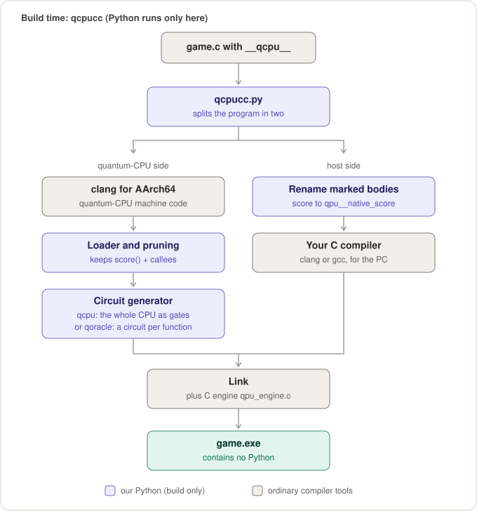
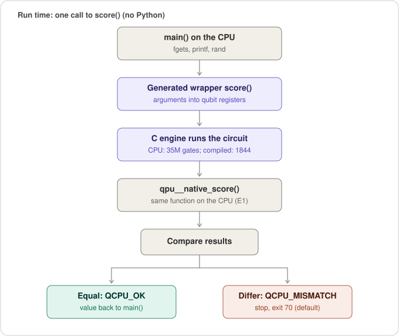

# cpu-qpu: run ARM64, RISC-V and x86-64 binaries on a quantum computer

Write an ordinary C program, compile it to an AArch64, RISC-V or x86-64 binary with clang or gcc, and run that
binary on a **quantum stored-program (von Neumann) processor** made entirely of quantum gates.
The program's output appears as if you had run it locally:

```
$ python3 arm_qpu.py hello.o
Hello from the QPU!
84 = 2 2 3 7
```

The quantum processor is **one fixed reversible circuit** (X, CNOT, Toffoli, Fredkin gates).
It has program memory, a program counter, fetch, a decoder for 27 A64 instruction classes,
31 registers + SP, NZCV flags, data memory with a stack, an ALU (adder, barrel shifter,
multiplier, divider, bitmask decoder), and a branch unit with calls and returns.
The binary is **not compiled into the circuit**: its 32-bit instruction words are loaded as
the initial state of the program-memory qubits. Nothing inside the circuit is measured or
classically dispatched. The same bytes also run on an ARM CPU emulator as a reference, so
every run is checked.

**Architectures.** The same tool runs AArch64 (`arm64`), RISC-V RV64IM (`riscv64`) and RV32IM
(`riscv32`), and x86-64 (`x86_64`) binaries; it reads the architecture from the file header.
`cpu_qpu.py` is the command; `arm_qpu.py` is the same tool under its original name. Most of this
README uses AArch64 for its examples; see "RISC-V" and "x86-64" below for what differs.

**Beyond whole programs on the quantum CPU:**

| what | how | section |
|---|---|---|
| Mark single C functions to run on the quantum CPU or as their own circuit | `__qcpu__`, `qcpucc` | [`__qcpu__`](#one-program-some-functions-on-the-quantum-cpu-__qcpu__), [two modes](#two-modes-qcpu-or-qoracle) |
| Grover's search with a C function as the oracle | `qcpu_search()` | [quantum search from C](#quantum-search-from-c-qcpu_search) |
| Run exported oracles on IBM hardware or its noise models | `qcpu_run.py`, `config.json` | [on a real quantum computer](#on-a-real-quantum-computer-qcpu_runpy) |
| One arm64 binary with quantum instructions and a classical fallback | `include/qarm.h`, `qarm_exec.py` | [Q-ARM v2](#q-arm-v2-one-binary-quantum-instructions-with-a-classical-fallback) |
| Q-ARM v2 on a real QPU: `QSEARCH` in one async job | `qarm_exec.py --qpu` | [Q-ARM v2](#q-arm-v2-one-binary-quantum-instructions-with-a-classical-fallback) |
| VQE: a molecule's ground-state energy, the optimizer in C | `QVLOAD`, `QEXPECT`, `QEXPECTN`, `QSESSION` | [VQE](#vqe-the-molecules-energy-from-a-c-optimizer) |
| The same source natively, on any CPU, with IBM over REST from C | `-DQARM_RUNTIME`, `runtime/libqarm` | [libqarm](#native-libqarm-the-q-arm-runtime-in-c) |
| The same arm64 binary under QEMU, with the real C library | `qemu-aarch64 -plugin libqarm-qemu.so` | [QEMU](#under-qemu-the-same-arm64-binary-with-the-real-c-library) |

## Quick start

`examples/hello.c` is plain C:

```c
#include <stdio.h>

int smallest_factor(int n) {
    for (int d = 2; d * d <= n; d++)
        if (n % d == 0)
            return d;
    return n;
}

int main(void) {
    int n = 84;
    printf("Hello from the QPU!\n");
    printf("%d =", n);
    while (n > 1) {
        int p = smallest_factor(n);
        printf(" %d", p);
        n /= p;
    }
    printf("\n");
    return 0;
}
```

**Step 1: compile it to an ARM64 binary** with clang or gcc:

```bash
clang --target=aarch64-linux-gnu -O1 -fno-stack-protector -Iinclude -c examples/hello.c -o hello.o
# or
aarch64-linux-gnu-gcc -O1 -fno-stack-protector -Iinclude -c examples/hello.c -o hello.o
```

`hello.o` is a normal AArch64 ELF object file: these are the bytes that run. `-Iinclude`
picks up the small `include/stdio.h` of this repository (no system headers or libc needed).
Inspect the machine code with `llvm-objdump -d hello.o`.

**Step 2: run the binary on the QPU:**

```bash
python3 arm_qpu.py hello.o
```

```
Hello from the QPU!
84 = 2 2 3 7
```

Like a local run, the exit code is `main`'s return value.

**Step 3 (optional): see what happened** with `-v`:

```bash
python3 arm_qpu.py hello.o -v
```

```
Hello from the QPU!
84 = 2 2 3 7
------------------------------------------------------------
MATCH: the QPU produced the same result as the CPU
return value X0: CPU = 0, QPU = 0
program output: CPU and QPU identical
quantum machine: 525162 qubits, 28273824 gates (13643064 Toffoli), 228 steps, W = 12
report: hello.main.report.md
```

The report (`.md` and `.json`) contains:
- the program output from both machines;
- registers, flags, data memory and the step-by-step PC trace compared between CPU and QPU;
- the disassembly, with every instruction marked supported or not and how often it ran;
- the circuit's resources and the model check.

`--report PREFIX` writes the report without printing the analysis.

**Run a single function** instead of `main`:

```bash
python3 arm_qpu.py factor.o --entry factorize --args 84 '&0'
# factorize(84, &0) = 4          (&0 = pointer to user data cell 0; the factors are written there)
```

Options: `--entry FUNC` (default `main`), `--args` for X0, X1, ... (`&k` = pointer to user data
cell k), `--mem=1,2,3` to initialise user data cells (32-bit), `-v`, `--report PREFIX`,
`--config config.json`.

*Shortcut:* `arm_qpu.py` also accepts a `.c` file and runs step 1 itself (`--cc clang|gcc`,
`-O 0|1|2|s`). The compile command it used is shown with `-v`. The binary is still what runs.

## Examples

| file | what it prints |
|---|---|
| `examples/hello.c` | a greeting and the factorization of 84 |
| `examples/factor.c` | prime factorizations of 84, 91 and 97 |
| `examples/algorithms.c` | gcd, Fibonacci, primality, popcount, integer square root, modular power, max |
| `examples/qarm/tiny_search.c` | Q-ARM `QSEARCH` for x = 3 in 2 bits, small enough for a real QPU (`qarm_exec.py`) |
| `examples/qarm/h2_vqe.c` | Q-ARM VQE: the ground-state energy of H₂, −1.137306 Ha (`qarm_exec.py`, or a plain CPU) |

```
$ python3 arm_qpu.py algorithms.o
Classic algorithms on a quantum von Neumann machine
  gcd(84, 36)      = 12
  fib(10)          = 55
  is_prime(89)     = yes
  popcount(109)    = 5
  isqrt(70)        = 8
  3^5 mod 13       = 9
  max3(-7, 12, 5)  = 12
```

The inputs go through a `volatile` variable, so the compiler cannot compute the answers in
advance: the QPU computes them. Each of the three programs takes a few seconds to
simulate on a laptop.

## RISC-V

```bash
python3 cpu_qpu.py examples/hello.c --arch riscv64        # compile for RV64IM and run
python3 cpu_qpu.py examples/factor.c --arch riscv32       # RV32IM
python3 cpu_qpu.py hello_rv.o                             # an object file: architecture from its header
python3 cpu_qpu.py hello_rv.o -v                          # + comparison with the CPU, resources, report
```

To compile yourself (clang is a cross-compiler for every architecture; no extra package is needed):

```bash
clang --target=riscv64-unknown-linux-gnu -march=rv64im -mabi=lp64  -mno-relax -fno-pic -O1 -fno-stack-protector -Iinclude -c examples/hello.c -o hello_rv.o
clang --target=riscv32-unknown-elf       -march=rv32im -mabi=ilp32 -mno-relax -fno-pic -O1 -fno-stack-protector -Iinclude -c examples/hello.c -o hello_rv32.o
```

`-march=rv64im` / `rv32im` selects the base integer instructions plus multiply/divide, without the
16-bit compressed instructions; `-mno-relax -fno-pic` gives plain relocations.

The RISC-V machine is a second front end on the same core as the AArch64 machine (below). It has
registers x1..x31 (x0 reads as zero), no flags, and one write port, so it is smaller:

| program (clang -O1, W = 12) | | AArch64 | RV64IM | RV32IM |
|---|---|---|---|---|
| `hello.c` | cycles | 228 | 236 | 236 |
| | qubits | 525 162 | 271 670 | 147 492 |
| | gates | 28.3 million | 13.7 million | 11.6 million |
| `factor.c` | cycles | 606 | 610 | 607 |
| | qubits | 1 372 896 | 683 551 | 361 702 |
| | gates | 81.6 million | 40.9 million | 35.2 million |

**Implemented:** LUI, AUIPC, JAL, JALR, BEQ/BNE/BLT/BGE/BLTU/BGEU, ADDI/SLTI/SLTIU/XORI/ORI/ANDI,
SLLI/SRLI/SRAI, ADD/SUB/SLL/SLT/SLTU/XOR/SRL/SRA/OR/AND, MUL, DIV/DIVU/REM/REMU, LW/SW, EBREAK (ends
the run); on RV64 also the W forms (ADDIW, ADDW, SUBW, SLLIW/SRLIW/SRAIW, SLLW/SRLW/SRAW, MULW,
DIVW/DIVUW/REMW/REMUW), LD/SD and LWU. `printf`, `puts` and `putchar` work as on AArch64.

**Not implemented** (reported before the run, and the circuit itself traps on them): byte and
halfword loads and stores, MULH/MULHSU/MULHU, compressed instructions, ECALL and CSRs, floating
point, atomics.

**Known limits of the W-bit model on RISC-V** (detected and reported, never returned as exact):

- RV64 code that turns an unsigned 32-bit value into a 64-bit index uses the pair
  `slli x, x, 32; srli x, x, 30`. The intermediate value does not fit a narrow register. clang emits
  it for some array loops at `-O1`/`-O2` (`bubble_sort`, `factor.c` at `-O2`). RV32 code has no such
  pair. Supporting the Zba extension (`sh2add.uw` and friends) would remove this limit.
- Division by a constant becomes a multiplication by a 32-bit constant (`digit_sum`), as on AArch64.
- clang `-O0` keeps boolean temporaries in single bytes (`collatz_steps`, `power_mod` at `-O0`).

The decoder accepts exactly the instruction patterns listed in `qcpu/rv.py`; every other word traps
in the circuit, also when the program is in superposition (`tests/test_riscv.py` runs a
superposition of a valid and an invalid instruction word).

## x86-64

```bash
python3 cpu_qpu.py examples/hello.c --arch x86_64         # compile for x86-64 and run
python3 cpu_qpu.py examples/factor.c --arch x86_64 --cc gcc
python3 cpu_qpu.py hello_x86.o -v                         # an object file: architecture from its header
```

To compile yourself:

```bash
clang --target=x86_64-linux-gnu -fno-pic -mno-sse -fno-asynchronous-unwind-tables -ffunction-sections -falign-loops=1 -O1 -fno-stack-protector -Iinclude -c examples/hello.c -o hello_x86.o
# or, on an x86-64 Linux machine, the native gcc:
gcc -fno-pic -mno-sse -fno-asynchronous-unwind-tables -ffunction-sections -falign-loops=1 -falign-functions=1 -falign-jumps=1 -falign-labels=1 -fcf-protection=none -O1 -fno-stack-protector -Iinclude -c examples/hello.c -o hello_x86.o
```

`-mno-sse` keeps the code to integer instructions and `-fno-pic` gives absolute addresses.
`-ffunction-sections` and the `-falign-...=1` flags keep alignment padding out of the code: assemblers
pad with prefixed multi-byte NOPs, which the machine does not implement. `-fcf-protection=none` stops
gcc from starting every function with ENDBR64.

x86-64 instructions are 1 to 15 bytes long, so this machine differs from the other two in its first
stages. Program memory holds bytes and the program counter is a byte offset. Each cycle fetches an
11-byte window at the PC, removes the REX prefix and the 0F escape byte, recognises the instruction
from its opcode and ModRM byte, works out where the displacement and the immediate are and how long
the instruction is, and adds that length to the PC. All of it is gates: with program memory in
superposition, instructions of different lengths are parsed in the same run. Operands can be in
memory, results overwrite the first operand, a byte result keeps the upper bits of its register, and
calls push the return address on the stack. `docs/x86.md` describes the circuit.

| program (clang -O1, W = 12) | | AArch64 | RV64IM | RV32IM | x86-64 |
|---|---|---|---|---|---|
| `hello.c` | cycles | 228 | 236 | 236 | 258 |
| | qubits | 525 162 | 271 670 | 147 492 | 301 029 |
| | gates | 28.3 million | 13.7 million | 11.6 million | 15.8 million |
| `factor.c` | cycles | 606 | 610 | 607 | 701 |
| | qubits | 1 372 896 | 683 551 | 361 702 | 803 886 |
| | gates | 81.6 million | 40.9 million | 35.2 million | 57.7 million |

The x86-64 machine sits between the other two. Per cycle it writes up to three registers (result, RDX,
RSP) and two memory cells; the RISC-V machine writes one register and up to two cells, the AArch64
machine up to four cells (pair instructions) and has 31 registers.

**Implemented:** MOV (register, memory, immediate; 8, 32 and 64 bits), MOVSXD, MOVZX/MOVSX from a byte
register, LEA, ADD/OR/AND/SUB/XOR/CMP, TEST, NEG, NOT, INC, DEC, IMUL (two- and three-operand),
CDQ/CQO, CDQE, DIV, IDIV, SHL/SHR/SAR (immediate, 1, CL), SETcc, CMOVcc, Jcc, JMP and CALL (relative,
register, memory), RET, PUSH, POP, LEAVE, NOP, HLT (ends the run). `printf`, `puts` and `putchar` work
as on the other architectures.

**Not implemented** (reported before the run, and the circuit itself traps on them): 16-bit operand
size and every other prefix, byte and word memory operands, AH/CH/DH/BH, ADC/SBB, rotates, one-operand
MUL/IMUL, XCHG, string instructions, x87/SSE/AVX, system instructions.

**Known limits of the W-bit model on x86-64** (detected and reported, never returned as exact):

- Flags the machine does not model: CF and OF after a shift, all four after IMUL, DIV and IDIV. It
  leaves them unchanged; a run that goes on to read one is reported. Compilers do not rely on them.
- A comparison whose difference does not fit W bits has other SF and OF values than on the CPU.
- Division by a constant becomes a multiplication by a 32-bit constant (`digit_sum`), as elsewhere.
- gcc `-O2` without SSE swaps two adjacent `int`s by packing both into one 64-bit word (`bubble_sort`).

The tests check this machine in two steps. First, single cycles on random byte strings: the circuit
must do exactly what the instruction model in `qcpu/x86.py` says, and trap on everything that is not a
valid instruction. This covers encodings no assembler emits. Second, boundary cases and random
programs against the CPU after every cycle, where a difference that the model check does not explain
fails the test.

### How architectures are organised

| file | role |
|---|---|
| `qcpu/core.py` | shared core: qubit allocation, gate helpers, adder, shifter, multiplier, dividers, the compute / copy / uncompute / commit cycle, simulation hooks |
| `qcpu/machine.py`, `qcpu/a64.py`, `qcpu/reference.py` | AArch64: circuit front end, class table and checker, CPU reference |
| `qcpu/rv_machine.py`, `qcpu/rv.py`, `qcpu/rv_reference.py` | RISC-V: the same three parts |
| `qcpu/x86_machine.py`, `qcpu/x86.py`, `qcpu/x86_reference.py` | x86-64: the same three parts |
| `qcpu/isa.py` | registry: one entry per architecture (machine, checker, reference, calling convention, entry state, compiler flags) |
| `qcpu/loader.py` | ELF / Mach-O loading, relocations and the output stub for each architecture |

A front end supplies fetch, decode and execute for one cycle; everything else is shared. Adding a
front end leaves the others unchanged gate for gate (`tests/test_fingerprint.py`).

## Grover search with a C function as the oracle

`grover.py` uses a compiled C predicate as the oracle of Grover's algorithm. The predicate is
ordinary C, `int f(int x)` returning 0 or 1, and runs as ARM machine code on the quantum machine:

```c
/* examples/grover_divisor.c */
int divides91(int x)
{
    return x > 1 && 91 % x == 0;
}
```

```bash
python3 grover.py examples/grover_divisor.c --entry divides91 --bits 4 --iterations 0,1,2,3
```

```
predicate divides91: 10 instructions, solutions over 0..15: [7, 13] (M = 2 of N = 16); cycles per input 5..9, common bound T = 9
machine: W = 8, 9 instruction classes, 16 program slots, 9 cycles: 1792 qubits, 81000 gates (47052 Toffoli) per run of U
basis check: the quantum machine computes f(x) correctly for all 16 inputs
simulator: exact sparse state vector; optimal number of iterations for M/N = 2/16: 2
k = 0: P(solution) exact 0.1250, theory 0.1250; measured 142/1000 = 0.142 [95% CI 0.122..0.165]; workspace restored with probability 1.0000
k = 1: P(solution) exact 0.7812, theory 0.7813; measured 796/1000 = 0.796 [95% CI 0.770..0.820]; workspace restored with probability 1.0000
k = 2: P(solution) exact 0.9453, theory 0.9453; measured 950/1000 = 0.950 [95% CI 0.935..0.962]; workspace restored with probability 1.0000
k = 3: P(solution) exact 0.3301, theory 0.3301; measured 344/1000 = 0.344 [95% CI 0.315..0.374]; workspace restored with probability 1.0000
PASS: amplitudes amplified as Grover's algorithm predicts, workspace restored in every shot
```

`x` is the low `--bits` bits of X0, put into superposition with Hadamard gates. One iteration is:

1. **U**: run the ARM machine for T cycles. X0 becomes f(x); the history stays in per-cycle registers.
2. **Z** on bit 0 of X0: phase −1 where f(x) = 1.
3. **U⁻¹**: run the machine backwards. X0 is x again, and all work registers and the history are back to 0.
4. **Diffusion** on the input qubits.

Different inputs take different paths through the code (5 to 9 cycles here); T is the largest
cycle count over the whole domain, so every branch halts. Before the quantum run, the tool checks
every input on the CPU (it must halt, return 0 or 1 and stay inside the W-bit model) and on the
quantum machine gate by gate. `--no-uncompute` drops step 3: the input then stays entangled with
the result and the history, and the success probability falls to 5% instead of 95%.

**Simulator.** The machine is a permutation circuit (X, CNOT, Toffoli, Fredkin), so with k input
qubits in superposition the state has at most 2^k nonzero amplitudes, however many qubits the machine
has. `qcpu/sparsesim.py` stores exactly those amplitudes. This is an exact simulation of the quantum
state, including the interference, and it runs in about a second. `--backend aer` uses Qiskit Aer
(matrix product state) instead; it agrees, but is practical only for tiny examples such as
`examples/grover_tiny.c`. `tests/test_grover.py` checks the sparse simulator against Qiskit's dense
statevector on random circuits and against Aer on the interpreter. All results are from simulation,
not from quantum hardware. Grover's algorithm gives a quadratic reduction in oracle calls, but the
interpreter makes each call far more expensive than a hand-built oracle, so this is a demonstration,
not a speed-up.

More examples: `examples/grover_square.c` (x² ≡ 9 mod 16, 4 solutions of 16, found with certainty in
one iteration), and `--bits 6` with `divides91` (2 solutions of 64, P = 0.999 after 4 iterations).

## Shor's algorithm with modexp written in C

`shor.py` factors a small number with Shor's algorithm. The classical core of the algorithm,
`a^x mod N`, is an ordinary C function that runs as ARM machine code on the quantum machine, with the
exponent `x` in superposition:

```c
/* examples/shor_modexp.c */
unsigned modexp(unsigned a, unsigned x, unsigned n)
{
    unsigned r = 1;
    while (x) {
        if (x & 1)
            r = r * a % n;
        a = a * a % n;
        x >>= 1;
    }
    return r;
}
```

```bash
python3 shor.py --N 15 --a 7
```

```
modexp: 18 instructions; a = 7, N = 15; exponent register: t = 8 qubits (x = 0..255)
CPU check: a^x mod N correct for all 256 exponents, 4..101 machine cycles, all inside the 9-bit model
machine: W = 9, 12 instruction classes, 32 program slots, 101 cycles: 6588 qubits, 2445210 gates (1145340 Toffoli) per run of U
circuit: H on x, U, copy, U^-1, inverse QFT: 6592 qubits, 4890480 gates
after U: X0 = a^x mod N in all 256 branches, every branch halted, no trap
after U^-1: exponent register restored: True; all 6580 work and history qubits back in their initial state: True
measurement of x, exact probabilities (textbook value in brackets):
    y =     0  P = 0.2500 (0.2500)  y/2^t = 0.0000  no order found
    y =    64  P = 0.2500 (0.2500)  y/2^t = 0.2500  r = 4 -> 15 = 3 x 5
    y =   128  P = 0.2500 (0.2500)  y/2^t = 0.5000  r = 4 -> 15 = 3 x 5
    y =   192  P = 0.2500 (0.2500)  y/2^t = 0.7500  r = 4 -> 15 = 3 x 5
largest difference from the textbook distribution: 6.1e-16
1000 shots (seed 2026): 777 gave the order r = 4, 777 gave the factors = 0.777 [95% CI 0.750..0.802]
exact probability per shot: order 0.7500, factors 0.7500; a uniformly random y would give the factors with probability 0.0586
RESULT: 15 = 3 x 5   (order of 7 modulo 15: r = 4)
```

One run is:

1. **H** on the exponent qubits: all 2^t exponents at once.
2. **U**: the ARM machine runs `modexp`. The loop runs once per bit of `x`, so the branches take
   different numbers of cycles (4 to 101 here); the machine runs for the largest.
3. **Copy** the result into a fresh register (CNOT gates).
4. **U⁻¹**: the machine runs backwards. The exponent and every work and history qubit are restored.
5. **Inverse quantum Fourier transform** on the exponent qubits, then measure them.
6. Classical: continued fractions turn the measured `y` into the order `r`; `gcd(a^(r/2) ± 1, N)`
   gives the factors.

| N | base a | exponent qubits | cycles | qubits | gates | P(factors) per shot | same for a random y |
|---|---|---|---|---|---|---|---|
| 15 = 3 × 5 | 7 | 8 | 4–101 | 6 592 | 4.9 million | 0.750 | 0.059 |
| 21 = 3 × 7 | 2 | 9 | 4–113 | 7 496 | 6.0 million | 0.623 | 0.045 |
| 33 = 3 × 11 | 5 | 11 | 4–137 | 9 480 | 8.6 million | 0.679 | 0.018 |
| 35 = 5 × 7 | 2 | 11 | 4–137 | 9 480 | 8.6 million | 0.706 | 0.011 |

Without `--a` the tool tries the bases 2, 3, 4, ... as the classical part of Shor's algorithm does:
for N = 33, bases 2 and 4 find the order but give no factor, and base 5 gives 3 × 11.
`--cc gcc` and `-O 2` work as well; `-O0` does not, because it keeps locals in memory.

**What is checked on every run.** The CPU runs `modexp` for every exponent of the domain (correct value,
halts, inside the W-bit model). After U, every branch of the superposition holds the right value and
has halted. After U⁻¹, the exponent is back and every work qubit is in its initial state. The exact
outcome distribution equals the textbook distribution of order finding, computed independently with a
classical FFT. With `--no-uncompute` (no step 4) the outcome is uniform and the success rate drops to
the chance level in the last column: the history must be uncomputed for the branches to interfere.

**What this shows, and what it does not.**

- The oracle is the general square-and-multiply routine, compiled by an ordinary C compiler. Nothing
  in it uses the order or the factors; the same binary serves every `a` and `N` that fit the register
  width.
- The numbers are tiny and everything is simulated (`qcpu/sparsesim.py`, exact; the circuit is far
  too large for Qiskit Aer). The simulator is checked against Qiskit's dense statevector on random
  circuits, and the QFT gate list against the discrete Fourier transform (`tests/test_shor.py`).
- It is not an efficient way to factor. A circuit built by hand for modular exponentiation needs
  about a dozen qubits for N = 15; the interpreter needs 6 592, almost all of them history. The speed-up
  belongs to Shor's algorithm. What the machine adds is that the classical part comes straight from
  compiled code.

## One program, some functions on the quantum CPU: `__qcpu__`

Mark a function with `__qcpu__` and build with `qcpucc` (or CMake). The rest of the program stays on the
CPU: input, output, the C library. Every call to a marked function runs on the quantum CPU (the
circuit of a whole processor, simulated by a small C engine inside the executable) and is checked
against the same function compiled for this computer. Design: [`docs/qcpu_spec.md`](docs/qcpu_spec.md).

```c
#include <qcpu.h>
__qcpu__ int score(int guess, int secret) { ... }    // pure: no I/O, no library calls
int main(void) { ... fgets(...); r = score(guess, secret); printf(...); }
```

```
$ python3 qcpucc.py examples/codebreaker/codebreaker.c -o codebreaker
qcpucc: codebreaker: qcpu: 1 __qcpu__ function(s) on the quantum CPU (AArch64, W = 16, 34 instructions, 23342 qubits, 143899 gates per cycle): score
$ ./codebreaker
Code Breaker: guess the 4-peg code, colours R G B Y (for example RGBY).
turn 1>   RRGG  black 2  white 0    [qcpu: 245 cycles, 35.3M gates on 565k qubits, checked]
turn 2>   RGBY  black 0  white 2    [qcpu: 245 cycles, 35.3M gates on 565k qubits, checked]
turn 3>   YYGG  black 4  white 0    [qcpu: 245 cycles, 35.3M gates on 565k qubits, checked]
Cracked in 3 turns!
```

With CMake: `include(cmake/QCPU.cmake)` and `add_qcpu_executable(codebreaker SOURCES codebreaker.c)`
(`add_qcpu_library` for a shared library); see `examples/codebreaker/CMakeLists.txt`.

`qcpucc` is optional. The same source builds with any plain C compiler (`clang -I runtime codebreaker.c`,
gcc, MSVC, or CMake's `add_executable`; in the example: `cmake -B build -DQCPU=OFF`). Then `__qcpu__`
means nothing, everything runs on the CPU, and `qcpu_last_call()` reports backend `none`.

How it works, at build time and at every call:

<p align="center"></p>
<p align="center"></p>

- **Build.** `qcpucc` compiles the sources twice. For the quantum CPU (AArch64 by default,
  `--qcpu-isa riscv64|riscv32|x86_64`) it keeps only the marked functions and what they call, here
  34 instructions; `main`, `fgets`, `printf` are left out. For the host it renames each marked body to
  `qpu__native_<name>` and links the calls to a generated wrapper. A marked function that uses the C
  library, or is `static`, is a build error. Host and quantum-CPU data models (`sizeof(long)`, the
  sign of `char`) are compared, and `-fsigned-char`/`-funsigned-char` is added to match the host.
- **Run.** `QCPU_MODE=native` runs the functions on the CPU instead (the older `QCPU_BACKEND=native` works
  too); `QCPU_VERIFY` (1), `QCPU_EXACT` (1),
  `QCPU_ON_FAIL=abort|native|status`, `QCPU_MAX_STEPS`, `QCPU_QUIET`. A call either returns exactly
  what the C function returns, or fails with a status (`QCPU_MISMATCH`, `QCPU_INCOMPLETE`, `QCPU_TRAP`,
  `QCPU_BAD_ARGS`, ...): by default the program stops with exit code 70 and a message. The program
  can read the last call's status, cycles, qubits and gates with `qcpu_last_call(&info)`.
- **Platforms.** Linux (x86-64, ARM64), macOS on Apple Silicon and Windows; `test_qcpucc` runs on all four
  in GitHub Actions. On a Mac: `python3 qcpucc.py examples/codebreaker/codebreaker.c -o codebreaker`
  (Apple clang does both sides). On Windows `long` is 4 bytes, on the quantum CPU 8: a function whose
  result depends on it is stopped with `QCPU_MISMATCH`, never returned wrong.
- **Two modes.** `--qcpu-mode qcpu` (the default, shown here) or `--qcpu-mode qoracle`, where each
  `__qcpu__` function becomes a circuit of its own, thousands of times smaller: see the next section.
- **Not yet:** run-time guards for loop bounds measured on samples (functions with loops need inputs of
  at most 16 bits for now), qoracle circuits that write memory, hardware drivers, and the E2/E3
  guarantees of the spec. `QPU_*` names still work as aliases.

## Two modes: qcpu or qoracle

`qcpucc` builds the quantum part of a program in one of two ways, chosen at build time:

| `--qcpu-mode` | what runs each `__qcpu__` function | `score()` per call | runs |
|---|---|---|---|
| `qcpu` (default) | a **quantum CPU**: a whole von Neumann machine of gates (program memory, program counter, decoder, ALU) executing the function's machine code, one instruction per cycle | 35.3 million gates on 565,000 qubits (245 cycles) | any supported code, on AArch64, RISC-V or x86-64 |
| `qoracle` | a **circuit of the function alone**, built by [qoracle](https://github.com/quantag/qoracle): no processor, just the function's logic as reversible gates (X, CNOT, Toffoli) whose work qubits return to 0 | 1,844 gates on 544 qubits (614 Toffoli) | functions that qualify (below); a function that does not is a build error |

The program contains only the circuits of the mode it was built with: a `qoracle` build of Code Breaker
is 50 KB, a `qcpu` build 1.8 MB. `--qcpu-mode qcpu,qoracle` embeds both. At run time the same keywords
select what runs:

| `QCPU_MODE` | runs | available |
|---|---|---|
| `qcpu` | the quantum CPU | when built with `qcpu` |
| `qoracle` | the function's own circuit | when built with `qoracle` |
| `native` | the function on the CPU, no circuit | always |
| (not set) | the mode it was built with (the first one if both) | |

A mode the program was not built with stops with a message naming the build option.

qoracle reads the function's AArch64 machine code (the same object file the `qcpu` mode uses), executes
it symbolically on all paths, reduces it to logic, and maps the logic to gates.

### Using it

```bash
python3 -m pip install "qoracle @ git+https://github.com/quantag/qoracle.git"    # also in requirements.txt

python3 qcpucc.py --qcpu-mode qoracle examples/codebreaker/codebreaker.c -o codebreaker
./codebreaker
```

```
qcpucc: codebreaker: qoracle: 1 __qcpu__ function(s) as circuits of their own: score
qcpucc:   score: qoracle circuit, 544 qubits (16 in, 6 out), 1844 gates (614 Toffoli); checked on all 65536 inputs
...
turn 1>   RRGG  black 2  white 0    [qoracle: 1844 gates on 544 qubits, checked]
```

With CMake: `add_qcpu_executable(game SOURCES game.c QCPU_MODE qoracle)`; in the example,
`cmake -B build -DQCPU_MODE=qoracle`. The build takes longer than `qcpu`: qoracle checks each circuit,
about 20 s for `score()`.

```bash
python3 qcpucc.py --qcpu-mode qcpu,qoracle examples/codebreaker/codebreaker.c -o codebreaker
./codebreaker                    # qcpu, the first mode listed
QCPU_MODE=qoracle ./codebreaker  # the same game with score() as its own circuit
QCPU_MODE=native ./codebreaker   # score() on the CPU
```

### Telling it the widths

A qoracle circuit has one qubit per input bit and per result bit, so it is smaller when it knows
how many bits a value really uses. Three annotations in the definition say so; a plain compiler and the
`qcpu` mode ignore them:

| annotation | meaning | without it |
|---|---|---|
| `QCPU_BITS(n)` on a parameter | the argument is `0 .. 2^n − 1` | the C type: `int` is 32 bits, signed |
| `QCPU_SBITS(n)` on a parameter | the argument is `−2^(n−1) .. 2^(n−1) − 1` | |
| `QCPU_RESULT_BITS(n)` before the name | the result is always `0 .. 2^n − 1` | the C type |

```c
// Code Breaker: codes are 8 bits, the answer is at most 4 * 8 = 32
__qcpu__ int QCPU_RESULT_BITS(6) score(int QCPU_BITS(8) guess, int QCPU_BITS(8) secret) { ... }
```

Each one is enforced:

- **Arguments** outside their declared bits are refused at the call, before the circuit runs:
  `QCPU_BAD_ARGS` ("argument 1 = 200 is outside its declared signed 8 bits (-128 .. 127)"), exit 70 by default.
- **`QCPU_RESULT_BITS`** is a claim about the function, so the build proves it, or fails. When every input
  is tested, the machine code is run on all of them; otherwise the higher result bits must be constant 0
  in the logic. A false claim gives a counterexample: "`f`: QCPU_RESULT_BITS(4) is wrong: for a = 15 the
  result is 16". The result is never silently cut.

### Which functions qualify for qoracle

| | qoracle circuit | build error: use `qcpu` |
|---|---|---|
| arguments and result | integers | buffers (`QCPU_IN/OUT/INOUT`), `void` result, no arguments |
| code | arithmetic, branches, loops, read-only tables | writing memory (local arrays, the stack), calls the compiler does not inline, floating point |
| checked on | every input, when the inputs total at most 16 bits | |
| or | no loops and no tables (then the translation is exact for all inputs; qoracle tests 4,096 inputs) | loops or tables with more than 16 input bits: needs run-time guards, not implemented yet |
| quantum-CPU ISA | AArch64 (`--qcpu-isa arm64`, the default) | RISC-V, x86-64 |

An example with a loop and a signed argument:

```c
__qcpu__ unsigned QCPU_RESULT_BITS(4) popcount(unsigned QCPU_BITS(12) x) {
    unsigned n = 0;
    while (x) { n += x & 1; x >>= 1; }
    return n;
}
__qcpu__ int triple(int QCPU_SBITS(8) a) { return 3 * a; }
```

```
qcpucc:   popcount: qoracle circuit, 479 qubits (12 in, 4 out), 1760 gates (578 Toffoli); checked on all 4096 inputs
qcpucc:   triple: qoracle circuit, 72 qubits (8 in, 32 out), 134 gates (26 Toffoli); checked on all 256 inputs
```

A function that writes a buffer cannot be a qoracle circuit yet:

```
qcpucc: error: bump: no qoracle circuit: it takes buffers (qoracle circuits cannot write memory yet). Build with --qcpu-mode qcpu (the default): the quantum CPU runs any supported code
```

### What a call guarantees

Nothing changes for the program: the same wrapper, the same settings, the same statuses. Every call
is still checked against the function compiled for this computer (`QCPU_VERIFY=1`, the default), and
`qcpu_last_call(&info)` reports `info.mode` (`"qoracle"`, `"qcpu"` or `"none"`), the circuit's
qubits and gates. So a qoracle call is checked twice: the circuit against the machine code at build
time, and the result against the native function at every call. The test suite also runs all 65,536
inputs of `score()` through the embedded circuit (`tests/test_qcpucc.py`, item 7, on Linux, macOS and
Windows).

### Why it matters

The quantum CPU shows that a whole von Neumann machine can be built from gates; it is far
too large for any quantum computer. A qoracle circuit is the size an algorithm can use: the same
compute-oracle form `|x⟩|y⟩ → |x⟩|y ⊕ f(x)⟩` that Grover search and Shor's algorithm need. The Grover
and Shor sections above run their C oracles on the whole quantum CPU (1,792 qubits for a 4-bit
predicate); qoracle's own README runs both with qoracle circuits. Still beyond today's hardware for
`score()` (614 Toffoli gates on noisy qubits), but within reach for small predicates: qoracle's
`is_root` is 26 qubits. Next steps: run-time guards for loops with wider inputs, and drivers for real
devices. Design: [`docs/qcpu_spec.md`](docs/qcpu_spec.md), section 5.5.

### Using the circuits in quantum programs: `--qcpu-export`

A `__qcpu__` function is ordinary C: one definite input in, one definite output out. A quantum
program (a CUDA-Q kernel, a Qiskit circuit) needs exactly such a classical function as an *oracle*,
applied to all inputs at once in superposition. `--qcpu-export DIR` writes each qoracle circuit for those
toolkits:

| file | for | contents |
|---|---|---|
| `f.qasm` | Qiskit (`qiskit.qasm3.load`), other OpenQASM 3 tools | the compute oracle `\|x⟩\|y⟩\|0⟩ → \|x⟩\|y ⊕ f(x)⟩\|0⟩` |
| `f_phase.qasm` | Grover's search | for a one-bit result, the phase oracle `\|x⟩\|0⟩ → (−1)^f(x) \|x⟩\|0⟩` |
| `f_cudaq.py` | CUDA-Q (Python) | the same circuits as `@cudaq.kernel` functions `f_oracle(q)` and `f_phase(q)` |
| `f.cudaq.h` | CUDA-Q (C++) | the same as `__qpu__` functions, for `nvq++` |
| `f.json` | any | which qubits are which argument, the result and the work qubits; gate counts |

Every file holds the circuit embedded in the program, checked against the function's machine code
(`checked on all 16 inputs`). The work qubits start and end in 0, so the oracle can be used
coherently. With CMake: `add_qcpu_executable(... QCPU_MODE qoracle QCPU_EXPORT oracle)`.

```c
__qcpu__ int QCPU_RESULT_BITS(1) is_five(unsigned QCPU_BITS(4) x) { return x == 5; }
```

```python
from is_five_cudaq import is_five_phase      # written by qcpucc --qcpu-export

@cudaq.kernel
def grover(iterations: int):
    q = cudaq.qvector(18)                     # 4 for x, 14 work qubits (IS_FIVE_PHASE_QUBITS)
    for b in range(4): h(q[b])
    for _ in range(iterations):
        is_five_phase(q)                      # the C function as the oracle
        for b in range(4): h(q[b]); x(q[b])   # diffusion
        z.ctrl(q[0], q[1], q[2], q[3])
        for b in range(4): x(q[b]); h(q[b])
    for b in range(4): mz(q[b])

cudaq.sample(grover, 3)    # about 96% of the shots: '1010' (q[0] first), x = 5
```

(Run it from a `.py` file or Jupyter: `@cudaq.kernel` reads the kernel's source.)

The Code Breaker solver of the next section also works from the exported file:
`examples/codebreaker/grover_solver.py oracle/consistent_phase.qasm` reads the 1,044-qubit phase oracle
and finds the secret with probability 0.9999 in 12 oracle calls. 1,044 qubits is far beyond a
state-vector simulator (CUDA-Q's included), but Grover puts only the 8 qubits of the secret in
superposition, so the script runs it exactly on 256 amplitudes.

What is checked (`tests/test_qcpu_export.py`, in CI): the exported compute oracles give the C
function's result for every input; Qiskit loads every file; in CUDA-Q 0.17 the exported Python kernels
run, right for every input, and Grover with the phase oracle finds the marked value; the C++ header
type-checks against CUDA-Q's own `cudaq.h` (running it needs `nvq++`, which is not part of the pip
package and has not been tried); the Code Breaker solver finds BYRG.

## Quantum search from C: `qcpu_search()`

A C program can also run a quantum algorithm itself. `qcpu_search(f, bits, &x)` looks for an `x` with
`f(x) == 1`, where `f` is a `__qcpu__` predicate: one argument with `QCPU_BITS(bits)`, and
`QCPU_RESULT_BITS(1)`. Built with `--qcpu-mode qoracle`, it is **Grover's search** with `f`'s phase
oracle, `|x⟩ → (−1)^f(x) |x⟩`, in the simulator built into the program; any answer is checked with an
ordinary call of `f` before it is returned.

**Code Breaker solver** (`examples/codebreaker/solver.c`): `consistent(secret)` says whether a secret
code fits the answers of a game so far, using the game's own scoring.

```c
__qcpu__ int QCPU_RESULT_BITS(1) consistent(int QCPU_BITS(8) secret)
{
    return answer(RRGG, secret) == 1 * 8 + 1 && answer(RGBY, secret) == 0 * 8 + 4 && answer(YRGB, secret) == 0 * 8 + 4;
}

int main(void)
{
    int secret;
    if (qcpu_search(consistent, 8, &secret))
        printf("the secret code: ...", ...);
}
```

```
$ python3 qcpucc.py --qcpu-mode qoracle examples/codebreaker/solver.c -o solver
qcpucc:   consistent: qoracle circuit, 1045 qubits (8 in, 1 out), 4255 gates (1074 Toffoli); checked on all 256 inputs
qcpucc:   consistent: phase oracle for qcpu_search(), 1044 qubits, 4255 gates
$ ./solver
the game so far: RRGG black 1 white 1, RGBY black 0 white 4, YRGB black 0 white 4
the secret code: BYRG
[Grover's search: 6 oracle call(s) in 9 round(s) over 256 inputs; consistent(78) = 1 checked]
```

| build or setting | how `qcpu_search` searches | calls of `consistent` for this game |
|---|---|---|
| `--qcpu-mode qoracle` | Grover's search with the phase oracle | 23.9 on average (40 runs: oracle calls plus checks), at most 61 |
| `QCPU_MODE=native`, `--qcpu-mode qcpu`, a plain C compiler | a classical search, every code in turn | 79 here; 128.5 on average for one code in 256 |

The number of solutions is not known in advance, so it is the randomized form of Grover's search
(Boyer, Brassard, Høyer and Tapp, 1998): rounds with a random number of iterations, growing, each ending
in a measurement that is checked. Several solutions: any one of them is returned. None: `qcpu_search`
returns 0 after about 4.5·√N oracle calls (with a solution, that is very unlikely). The result of each
run varies with the measurements; `QCPU_SEED=n` makes a run repeatable. `qcpu_last_call(&info)` reports
`info.mode` (`"grover"` or `"classical"`), the oracle calls in `info.cycles`, and a message.

How the simulation works: between oracle calls only the 8 qubits of the argument are in
superposition, so the state is 256 amplitudes, updated exactly. To get the oracle's effect, the
simulator runs its 4,255 gates on each of the 256 basis inputs once, which a simulator cannot avoid; a
quantum computer would apply them to all inputs at once, in each of the calls. Up to 24 bits.

## On a real quantum computer: `qcpu_run.py`

`qcpu_run.py` takes a phase oracle exported by `qcpucc --qcpu-export`, builds a quantum algorithm around
it, and runs it on a simulator, on the noise model of a real IBM device, or on a real IBM quantum
computer. Two algorithms are small enough for today's devices:

| algorithm | C function | what it shows | on the noise model of IBM Fez |
|---|---|---|---|
| `bv`: Bernstein–Vazirani | `int hidden(int QCPU_BITS(8) x) { return __builtin_parity(x & 0xB5); }` | the hidden mask in **one** call of the function; a classical program needs 8 | 181 = 0xB5 in 89% of shots (random guess: 0.4%); 22 two-qubit gates |
| `grover`: Grover's search | `int is_three(int QCPU_BITS(2) x) { return x == 3; }` | the marked input after one oracle call | 3 in 73% of shots (random: 25%); 155 two-qubit gates |

```bash
python3 qcpucc.py --qcpu-mode qoracle --qcpu-export oracle hidden.c -o hidden
python3 qcpu_run.py bv oracle/hidden_phase.qasm --expect 0xB5 --backend preview     # noise model, no account
python3 qcpu_run.py bv oracle/hidden_phase.qasm --expect 0xB5 --backend ibm         # a real IBM quantum computer
```

```
bv with hidden (int hidden(int x)) on preview: noise model of fake_fez (156 qubits); no account used
  circuit: 9 qubits, 1 oracle call(s), 22 two-qubit gates and depth 62 on the device; 1024 shots in 9.3 s
  x =    181  (10110101)     915 shots   89.4%
  the expected answer 181: 89.4% of shots (a random guess: 0.4%)
```

**Backends** (`backend` in `config.json`, or `--backend`): `simulator` (ideal), `aer`, `preview` (the
noise model of an IBM device, `"options": {"device": "fez"}`; no account), `ibm` (a real device, with
the options below). `--save run.json` keeps the result, with the job id.

**Your IBM Quantum account.** The free Open Plan is enough: these circuits take seconds. Copy
`config.example.json` to `config.json` and fill in your API key, instance and device. Git ignores
`config.json`, so the key is never committed:

```json
{
  "backend": "ibm",
  "mode": "sampler",
  "shots": 1024,
  "options": {
    "ibm_token": "your IBM Quantum API key",
    "instance": "your instance (CRN or name)",
    "device": "ibm_aachen"
  }
}
```

`"device": "least_busy"` takes whichever device is least busy. `"ibm_token": "env:IBM_QUANTUM_TOKEN"`
reads the key from that environment variable instead.

Larger oracles are still too deep for today's noise: Grover on 3 and 4 bits with the circuits
qoracle makes now. `x == 3` should be one controlled-Z; it is 12 Toffoli gates today, since qoracle
follows the machine code's comparison literally. Smaller circuits for small functions are the next step.

## Q-ARM v2: one binary, quantum instructions with a classical fallback

An ordinary arm64 program can contain quantum instructions that a plain CPU skips. `include/qarm.h`
gives C two of them: `qarm_available()` and `qarm_search(f, bits, &x)`, Grover's search for an `x` with
`f(x) == 1`. On a plain CPU they take the classical path. Under the Q-ARM runtime `qarm_exec.py`, the same
binary runs its ordinary instructions in a 64-bit ARM emulator and its quantum instructions on a quantum
coprocessor (the exact simulator). The oracle is built from `f`'s machine code in the binary, and each
answer is checked by running `f` itself.

```
$ clang -O1 -iquote include examples/qarm/codebreaker_search.c -o codebreaker_search
$ ./codebreaker_search                       # on an arm64 Mac or Linux machine
searching classically on this CPU
the secret code: BYRG
$ python3 qarm_exec.py codebreaker_search    # the same file
searching with Grover's search on the quantum coprocessor (Q-ARM)
[qarm: QSEARCH consistent, 8 bits: Grover's search with a 1066-qubit, 4349-gate oracle from consistent's machine code: x = 78 after 31 oracle calls in 15 rounds, checked by running consistent]
the secret code: BYRG
```

Build the predicate with `-O1` and its helpers inlined (vector instructions and calls cannot become an
oracle yet). Design, packet format, the runtime and its limits: [`docs/qarm_v2.md`](docs/qarm_v2.md).

`QSEARCH` can also run on a real IBM quantum computer, or on IBM's noise model of one, from `config.json`.
The demo is `examples/qarm/tiny_search.c`, a 2-bit predicate whose oracle takes 9 qubits:

```
$ python3 qarm_exec.py --backend preview tiny_search   # noise model of IBM Fez, no account
$ python3 qarm_exec.py --qpu tiny_search               # config.json's backend, e.g. "ibm"
```

A QPU is asynchronous, so `QSEARCH` sends one job with all of Grover's iteration counts and waits for it.
Every answer is still checked by running the program's own function, and an oracle larger than the device
is refused before anything is submitted ([`docs/qarm_v2.md`](docs/qarm_v2.md#5-on-a-real-qpu)).

### VQE: the molecule's energy from a C optimizer

Five more instructions (`QVLOAD`, `QEXPECT`, `QEXPECTN`, `QSESSION`, `QVFREE`) let a C program run the
variational quantum eigensolver. The optimizer is the program's own code on the CPU. The coprocessor
measures ⟨ψ(θ)|H|ψ(θ)⟩ for a Hamiltonian and an ansatz described in two C tables. On a plain CPU,
`qarm.h` computes the energy exactly from the state vector.

```
$ clang -O1 -iquote include examples/qarm/h2_vqe.c -o h2_vqe -lm
$ ./h2_vqe                                         # exact, on this CPU
$ python3 qarm_exec.py --backend preview h2_vqe    # noise model of IBM Fez, readout corrected
$ python3 qarm_exec.py --qpu h2_vqe                # config.json's device: 5 jobs in all
```

H₂ at 0.735 Å takes 2 qubits and one CNOT. The exact result is −1.137306 Ha; the noise models of Fez and
Torino give it to within about 10–35 mHa. Each batch of parameter vectors is one job, so an async QPU
queues once per optimizer round ([`docs/qarm_v2.md`](docs/qarm_v2.md#6-vqe)).

### Native: libqarm, the Q-ARM runtime in C

The same source also builds natively, on any CPU, with no emulator and no Python at run time. libqarm
(`runtime/libqarm`) computes the energies exactly, samples them, or runs them on a real IBM device over
IBM's REST API. To do that it transpiles the circuits in C to the device's gates and connected qubits,
sends one asynchronous job per batch, and corrects the readout:

```
$ cc -O2 -DQARM_RUNTIME -iquote include examples/qarm/h2_vqe.c runtime/libqarm/*.c -o h2_vqe -lcurl -lm
$ ./h2_vqe                                  # exact
$ QARM_CONFIG=config.json ./h2_vqe          # config.json's IBM device
```

`qarm.h` also gains an asynchronous form, `qarm_expect_n_async`, `qarm_job_ready` and `qarm_job_wait`,
so the CPU keeps working while a job is queued. The `ibm` backend is tested against a local mock of
IBM's API that rejects any non-ISA circuit; it has not run on a real device yet
([`docs/qarm_v2.md`](docs/qarm_v2.md#7-the-native-runtime-libqarm)).

### Under QEMU: the same arm64 binary, with the real C library

`runtime/qemu` is a plugin for `qemu-aarch64` (QEMU 10.1 or newer). It runs the ordinary arm64 build of a
Q-ARM program, the same bytes as on a plain ARM CPU, and executes its Q-ARM packets with libqarm:

```
$ cmake -S runtime/qemu -B build/qemu -DQEMU_PLUGIN_INCLUDE=$HOME/qemu/include && cmake --build build/qemu
$ qemu-aarch64 -L /usr/aarch64-linux-gnu -plugin build/qemu/libqarm-qemu.so ./h2_vqe
$ qemu-aarch64 -plugin build/qemu/libqarm-qemu.so,config=config.json ./h2_vqe     # a real IBM device
```

Unlike `qarm_exec.py`, it runs programs that use the real C library: files, `malloc`, `qsort`
(`examples/qarm/vqe_from_file.c`). It is also about 12x faster on `h2_vqe`. `QSEARCH` takes its classical
path there for now ([`docs/qarm_v2.md`](docs/qarm_v2.md#8-q-arm-under-qemu)).
No speedup today; the point is the model: one binary, the quantum path where a coprocessor exists,
the classical path elsewhere, both computing the same function.

## Q-ARM: quantum gates inside an ARM binary

Q-ARM embeds OpenQASM 2 unitary gates in an AArch64 binary as *CPU-skippable packets*: each packet starts
with a branch over itself, so an ordinary ARM CPU skips the quantum part and runs the rest of the
program unchanged, while the quantum interpreter recognizes the packet and applies its gates
coherently.

```bash
python3 qarm.py compile examples/qarm/bell.qasm -o bell
python3 qarm.py run bell.bin
```

The packet format, the ABI and what is supported are in [`docs/qarm.md`](docs/qarm.md); validation in
[`docs/qarm_validation.md`](docs/qarm_validation.md). This first, coherent version has no reset,
mid-circuit measurement or classical feedback. Plain ARM behavior is unchanged. Test:
`python3 -m pytest -q tests/test_qarm.py`.

## Calling QPU functions from a host program, like a DLL

A host program can call functions that run on the quantum machine as ordinary C functions, through
a shared library (Linux `.so`, Windows `.dll`). `qpu_dll.py` compiles the library for the QPU, builds
the quantum machine's circuit for that code, and puts the circuit into the library as data, with a
small C engine that runs it. At run time there is only the program and the library: no Python, no
server, no network.

```c
// mathlib.h                                 // main.c, the host program: plain C
#include "qpu_dll.h"                         #include <stdio.h>
int gcd(int a, int b);                       #include "mathlib.h"
int sum(const int *QPU_IN(n) v, int n);      int main(void) {
void sort(int *QPU_INOUT(n) v, int n);           int v[] = {9, -3, 7, 1, 0, 4};
                                                 printf("%d\n", gcd(84, 36));   // runs on the QPU
                                                 sort(v, 6);                    // so does this
                                             }
```

```bash
python3 qpu_dll.py mathlib.c --header mathlib.h --arch arm64 -o libmathlib_qpu.so    # Windows: -o mathlib_qpu.dll
cc -I runtime main.c -L. -lmathlib_qpu -Wl,-rpath,'$ORIGIN' -o main
./main
```

The engine runs the same gates as the Python simulator (the tests compare the two on every qubit),
and each call is checked against the same function compiled for the host. Integers and `int` buffers
cross the boundary; values must fit the register width (16 bits by default), and a call where one
does not is reported. Library functions cannot print. Example, rules and settings:
`examples/dll/README.md`.

## How printf works

All computation, including every value that gets printed, happens on the QPU. Text formatting
happens on the host:

1. The linker step in `arm_qpu.py` binds `printf`, `puts` and `putchar` to a small output stub,
   about 20 A64 instructions that run on the QPU like any other code.
2. Each call appends a record to an **output log** in data memory: the kind of call, the format
   string's address and the integer or pointer arguments.
3. After the run, the log is read out of the measured data memory and formatted on the host
   with C printf rules. The format strings come from the program's `.rodata`.
4. The CPU reference runs the same stub, so the two outputs are compared; `-v` shows the result.

This is how a real computer works too: the CPU writes to an output device, and the text is
drawn elsewhere. On a quantum computer it also keeps the circuit coherent to the end, because
everything is measured once, after the run.

Limits: integers and pointers only (no `%f`); up to 6 arguments per call; `%s` works for
string constants, not for text built in memory at run time; 32 output calls per run by
default (`output_records`). Return values: `putchar` returns its character and `puts`
returns 0, as in C. `printf` returns 0, not the number of characters written, because the
text is only formatted after the run. `printf("text\n")` is often turned into `puts` by the compiler,
which is supported.

## Compiling C to an ARM64 binary: clang or gcc

Both compilers are supported and tested; they produce the same results. Compile with `-c` to
an object file (`.o`) and pass that file to `arm_qpu.py`. Recommended flags:
`-O1 -fno-stack-protector -Iinclude`. Ubuntu's gcc enables a stack protector by default, which
needs a libc symbol.

| compiler | command | output |
|---|---|---|
| clang, any OS (cross-compiles, no ARM machine needed) | `clang --target=aarch64-linux-gnu -O1 -fno-stack-protector -Iinclude -c prog.c -o prog.o` | ELF |
| clang on macOS, Apple Silicon | `clang -O1 -fno-stack-protector -Iinclude -c prog.c -o prog.o` | Mach-O |
| gcc, Linux cross toolchain | `aarch64-linux-gnu-gcc -O1 -fno-stack-protector -Iinclude -c prog.c -o prog.o` | ELF |
| gcc, Arm GNU Toolchain (Windows, macOS, Linux) | `aarch64-none-elf-gcc -O1 -fno-stack-protector -Iinclude -c prog.c -o prog.o` | ELF |
| gcc on a native ARM64 Linux machine (Raspberry Pi, Graviton, ...) | `gcc -O1 -fno-stack-protector -Iinclude -c prog.c -o prog.o` | ELF |

Programs use no libc beyond `printf`/`puts`/`putchar`; there is no `malloc` or file I/O.

## Step-by-step: Linux (Ubuntu / Debian)

```bash
# 1. tools: Python, git, and a compiler (clang, or gcc for AArch64, or both)
sudo apt update
sudo apt install -y python3 python3-venv git clang llvm gcc-aarch64-linux-gnu

# 2. get the code and its Python packages
git clone https://github.com/quantag/arm-qpu.git
cd arm-qpu
python3 -m venv .venv
source .venv/bin/activate
pip install -r requirements.txt

# 3. compile C to an ARM64 binary: with clang ...
clang --target=aarch64-linux-gnu -O1 -fno-stack-protector -Iinclude -c examples/hello.c -o hello.o
#    ... or with gcc
aarch64-linux-gnu-gcc -O1 -fno-stack-protector -Iinclude -c examples/hello.c -o hello.o

# 4. (optional) look at the ARM machine code you are about to run
llvm-objdump -d hello.o

# 5. run the binary on the quantum machine
python3 arm_qpu.py hello.o

# 6. (optional) CPU/QPU comparison, resources, report
python3 arm_qpu.py hello.o -v
```

On Fedora: `sudo dnf install clang llvm gcc-aarch64-linux-gnu python3 git`. On Arch Linux:
`sudo pacman -S clang llvm aarch64-linux-gnu-gcc python git`.

## Step-by-step: Windows

### Option A: native Windows (PowerShell)

```powershell
# 1. Python, git and clang/LLVM (clang includes the AArch64 cross compiler)
winget install -e --id Python.Python.3.12
winget install -e --id Git.Git
winget install -e --id LLVM.LLVM
# the LLVM installer does not add itself to PATH: add it (current window + permanently)
$env:Path += ";C:\Program Files\LLVM\bin"
[Environment]::SetEnvironmentVariable("Path", [Environment]::GetEnvironmentVariable("Path", "User") + ";C:\Program Files\LLVM\bin", "User")
clang --version            # must print a version; if not, open a NEW PowerShell window

# 2. get the code and its Python packages
git clone https://github.com/quantag/arm-qpu.git
cd arm-qpu
py -m venv .venv
.venv\Scripts\Activate.ps1        # if blocked: Set-ExecutionPolicy -Scope CurrentUser RemoteSigned
pip install -r requirements.txt

# 3. compile C to an ARM64 binary with clang
clang --target=aarch64-linux-gnu -O1 -fno-stack-protector -Iinclude -c examples\hello.c -o hello.o

# 4. (optional) look at the ARM machine code
llvm-objdump -d hello.o

# 5. run the binary on the quantum machine
python arm_qpu.py hello.o

# 6. (optional) CPU/QPU comparison, resources, report
python arm_qpu.py hello.o -v
```

**gcc on Windows.** Use the Arm GNU Toolchain:

1. Download the Windows-hosted (mingw-w64) package for the target "AArch64 bare-metal
   (aarch64-none-elf)" from https://developer.arm.com/downloads/-/arm-gnu-toolchain-downloads.
2. Unzip it, for example to `C:\arm-gnu-toolchain`.
3. Add its `bin` folder to PATH, then check: `aarch64-none-elf-gcc --version`.
4. Compile with gcc instead of clang (step 3 above), then run the binary as before:

```powershell
aarch64-none-elf-gcc -O1 -fno-stack-protector -Iinclude -c examples\hello.c -o hello.o
python arm_qpu.py hello.o
```

To run a single function with a pointer argument, quote it: `'&0'` in PowerShell, `"&0"` in
`cmd.exe`.

### Option B: WSL2 (Linux inside Windows)

```powershell
wsl --install -d Ubuntu      # once, then reboot and open "Ubuntu" from the Start menu
```

Inside Ubuntu, follow the Linux steps above. This gives you both compilers through `apt`.

## Step-by-step: macOS (Apple Silicon)

```bash
# 1. tools: Apple clang compiles natively for arm64
xcode-select --install

# 2. code and Python packages
git clone https://github.com/quantag/arm-qpu.git && cd arm-qpu
python3 -m venv .venv && source .venv/bin/activate && pip install -r requirements.txt

# 3. compile C to an ARM64 binary (a native arm64 Mach-O object)
clang -O1 -fno-stack-protector -Iinclude -c examples/hello.c -o hello.o
#    or with gcc:  brew install aarch64-elf-gcc
#                  aarch64-elf-gcc -O1 -fno-stack-protector -Iinclude -c examples/hello.c -o hello.o

# 4. run the binary on the quantum machine
python3 arm_qpu.py hello.o
```

### Running a program built on your Mac

A complete macOS executable, as Xcode's clang builds it on an M-series MacBook, runs unchanged:

```bash
clang -O1 examples/hello.c -o hello     # an ordinary arm64 macOS program; ./hello runs it on the Mac
python3 cpu_qpu.py hello                # the same file on the quantum machine
```

The loader takes the executable apart the way `dyld` would put it together: it finds `main`, turns
calls through the `__stubs` table into calls to the machine's own `printf`/`puts`/`putchar`, makes
`exit()`, `abort()` and a failed stack check halt the machine (the exit status is kept), points the
stack-protector guard at a zero word, and rebuilds the PC-relative references and the data pointers
(classic dyld info or chained fixups) for the machine's address space. `-O0` to `-O2` work; programs
must stay within the supported instruction classes and the W-bit model (see below). Two common limits
for real programs: byte and halfword loads and stores (string handling, `char` arrays) are not yet
implemented on AArch64, and calls to library functions other than the ones above are reported as
unresolved. `python3 -m tests.test_macos` builds such executables off a Mac (`ld64.lld` and a stub
`libSystem`, both dyld-info and chained-fixup formats) and checks that each run prints the same text and
returns the same exit status as the program compiled natively.

## config.json

Every tool reads `config.json` in this repository: your own file, which git ignores because it can
hold your IBM Quantum API key. Copy `config.example.json` to start. Without `config.json` every setting
has its default (shown here as one file):

```json
{
  "backend": "simulator",
  "mode": "sampler",
  "shots": 1024,
  "options": {},
  "register_width": "auto",
  "registers": "auto",
  "memory_words": "auto",
  "max_steps": "auto",
  "isa": "full",
  "memory_select": "tree",
  "compiler": "auto",
  "cflags": ["-O1", "-fno-stack-protector"],
  "output_records": 32,
  "stack_bytes": 256
}
```

| key | meaning |
|---|---|
| `backend` | `simulator`: exact simulation of the circuit on its basis-state input (fast, any size). `aer`: Qiskit Aer, sampled with `shots`. `ibm`: IBM Quantum hardware through Qiskit Runtime. `preview` (`qcpu_run.py` only): the noise model of an IBM device. |
| `mode` | the Qiskit Runtime primitive: `sampler` (measurement counts; the only one so far). |
| `shots` | measurements per run (default 1024). |
| `options` | settings of the chosen backend. `ibm`: `ibm_token` (or `env:VAR`), `instance`, `device` (a name or `least_busy`), `channel` (default `ibm_quantum_platform`), `optimization_level` (default 1). `aer`: `method` (default `matrix_product_state`). `preview`: `device` (`fez`, `torino`, ...). |
| `arch` | architecture for `.c` input and raw binaries when `--arch` is not given: `arm64` (default), `riscv64`, `riscv32`, `x86_64`. Object files carry their own. |
| `register_width` | W, bits per register (8 to 16). `auto` = smallest W that holds the code and data addresses. |
| `registers` | `auto` = only registers the code uses; `all` = X0..X30; or a list. |
| `memory_words` | data memory in 4-byte cells; `auto` = enough for the output log, data sections, user cells and stack. |
| `max_steps` | machine cycles in the circuit; `auto` = what the CPU reference needed. |
| `isa` | `full` = decoder implements every supported class; `auto` = only the classes the program uses (smaller circuit). |
| `memory_select` | how the circuit selects a program slot or a data cell from an address. `tree` (default): one binary decoder per address, about three gates per slot. `comparator`: one comparator per slot, the original circuit; see "Two ways to select memory" below. x86-64 has only `tree`. |
| `compiler` | for `.c` input: `auto`, `clang`, `gcc`, or a command name / path. |
| `cflags` | compiler flags for `.c` input, default `["-O1", "-fno-stack-protector"]`. |
| `output_records` | how many printf/puts/putchar calls the output log keeps (default 32). |
| `stack_bytes` | stack reserved at the top of data memory (default 256). |

The older form, with `"ibm": {"token": ..., "backend": ...}` and `"aer": {"method": ...}` sections, is
still read.

Before submitting to hardware the runner checks the circuit's width against the device. A run
that does not fit is reported as not submitted, with the reason.

### Two ways to select memory

Every cycle the machine picks one program slot (fetch) and up to a few data cells (loads and stores)
by address. The first version of the AArch64 machine, which is the one described in the paper, does
this with one comparator per slot: each slot checks "is the address equal to my number?" with a
multi-controlled gate over all address bits, for every port, so the cost per slot grows with the
logarithm of the memory size. The default now is a binary decoder: a tree decodes the address once
into one select line per slot, for about three gates per slot (one Toffoli and two CNOTs).

| `hello.c`, clang -O1, W = 12 | | comparator | tree |
|---|---|---|---|
| AArch64 | qubits | 520 364 | 525 162 |
| | gates | 91.9 million | 28.3 million |
| | Toffoli | 57.8 million | 13.6 million |
| RV64IM | qubits | 269 902 | 271 670 |
| | gates | 39.2 million | 13.7 million |
| RV32IM | qubits | 145 724 | 147 492 |
| | gates | 31.0 million | 11.6 million |

The two circuits compute the same thing. The tree needs a few more scratch qubits and about a third
of the gates when the program has data memory; for a machine without data memory and with a few
program slots (the Grover and Shor oracles) the difference is a few percent. To build the original
circuit, with exactly the gate counts of the paper, set `"memory_select": "comparator"`
(`tools/compare_specialized.py --comparator` for the comparison with a specialised circuit).
`tests/test_fingerprint.py` checks that those circuits have not changed in any gate.

## What is implemented

| group | instructions |
|---|---|
| move | MOVZ, MOVN, MOVK, MOV (all aliases) |
| arithmetic | ADD, ADDS, SUB, SUBS (immediate, shifted register, extended register), CMP, CMN, NEG |
| logic | AND, ORR, EOR, ANDS, BIC, ORN, EON, BICS (register and bitmask immediate), TST, MVN |
| shifts / bitfields | LSL, LSR, ASR (immediate and register), UBFM, SBFM, UBFX, SBFX, UBFIZ, SBFIZ, UXTB/H, SXTB/H/W |
| multiply / divide | MUL, MADD, MSUB, MNEG, SMULL, UMULL, SMADDL, UMADDL, SDIV, UDIV |
| conditional | CSEL, CSINC, CSINV, CSNEG, CSET, CSETM, CINC, CNEG, CCMP, CCMN |
| branches | B, B.cond, CBZ, CBNZ, TBZ, TBNZ, BL, BLR, BR, RET |
| memory | LDR, STR, LDRSW (unsigned offset, unscaled LDUR/STUR, pre-index, post-index, register offset with LSL/UXTW/SXTW), LDP, STP (offset, pre-, post-index) |
| addresses | ADRP + ADD :lo12: (addresses of string literals and globals) |
| output | `printf`, `puts`, `putchar` (see "How printf works") |
| other | NOP and hints; HLT ends the run |

Anything else (byte/halfword loads and stores, ROR, BFI/BFXIL, CLZ/REV, ADR, floating point,
SIMD, system instructions) is listed in the report's "Unsupported instructions" table. A run that
reaches one stops with a trap; the CPU reference reports it first.

## The W-bit model, and when results are exact

The quantum registers are W bits wide. A W-bit register stands for the 64-bit (or 32-bit)
value you get by sign-extending it. When every value of a run has that form, the quantum
machine reproduces the AArch64 result exactly: the low W bits of every register and memory
cell, the NZCV flags, and the control flow.

The CPU reference checks every value of the run and lists any that does not fit in the
report's "Model check" section. Example: clang at `-O1` (and gcc at every level) compiles
`n / 10` as a multiply by `0xCCCCCCCD` and a 35-bit shift. Those values cannot fit in W ≤ 16,
so the report flags them. With clang at `-O0` the same function is a real `sdiv` and matches.

Code addresses are `4 × slot` and data pointers are offsets into data memory. Both must be
non-negative W-bit values, which is why `register_width: auto` grows W with program size.

## Tests

```bash
python3 -m tests.test_c_programs clang   # C cases x -O0/-O1/-O2 + whole programs with printf
python3 -m tests.test_c_programs gcc     # the same with aarch64-linux-gnu-gcc
python3 -m tests.test_c_programs clang riscv64   # the same C cases compiled for RV64IM (riscv32: RV32IM)
python3 -m tests.test_riscv 150 7 8,12,16        # RISC-V: decoder, traps, boundary cases, random programs
python3 -m tests.test_c_programs clang x86_64    # the same C cases compiled for x86-64 (also: gcc x86_64)
python3 -m tests.test_x86 150 7 8,12,16          # x86-64: decoder, circuit vs instruction model, traps, boundary cases, random programs
python3 -m tests.test_macos             # linked macOS arm64 executables (Mach-O), dyld info and chained fixups
python3 -m tests.test_dll                        # QPU libraries: host program + generated .so/.dll; C engine == Python simulator
python3 -m pytest -q tests/test_qarm.py         # Q-ARM: OpenQASM packets in AArch64 binaries, skipped by a CPU
python3 -m tests.test_qcpu_export                # qoracle circuits as OpenQASM 3 and CUDA-Q kernels; Grover
python3 -m tests.test_qcpu_search                # qcpu_search(): Grover's search from C
python3 -m tests.test_qarm_exec                  # Q-ARM v2: one arm64 binary on a CPU and under qarm_exec.py (and on QPU backends)
python3 -m tests.test_qarm_vqe                   # Q-ARM v2 VQE: H2 on a CPU, the runtime, Aer, IBM noise models
python3 -m tests.test_libqarm                    # libqarm, native: exact, simulator, ibm against a mock of IBM's API
QARM_QEMU=~/qemu/bin/qemu-aarch64 python3 -m tests.test_qarm_qemu   # Q-ARM in QEMU 10.1+ (the plugin of runtime/qemu)
python3 -m tests.test_qcpu_run                   # qcpu_run.py: Bernstein-Vazirani and Grover on simulators and IBM device models
python3 -m tests.test_qcpucc                     # __qcpu__ programs: Code Breaker, pruning, several files, exactness, data models
python3 -m tests.test_fingerprint        # no circuit changed by accident (AArch64 as before the ISA layer)
python3 -m tests.test_fuzz 300 7 8,12,16 # random A64 programs at three register widths
python3 -m tests.test_edges 8,12,16      # boundary cases: extensions, flags, shifts, W/X forms, memory, mul/div
python3 -m tests.test_simulators         # fast replay == fully materialised circuit == Qiskit Aer
python3 -m tests.test_coherence          # a superposition of two ARM programs, and interference
python3 -m tests.test_branching          # a superposed input taking two paths of different length
python3 -m tests.test_grover             # Grover search with compiled C predicates as oracles
python3 -m tests.test_shor               # Shor's algorithm with modexp compiled from C
python3 tools/compare_specialized.py     # interpreter vs a specialised reversible circuit
python3 tools/test_report.py             # runs everything, writes docs/test_results.md
```

Every comparison with the CPU is done after **every machine cycle** (registers, flags, data memory,
PC), not only at the end. Each run falls into one class: *match*; *match-flagged* (it matched, but
the model check reported values outside the W-bit model); *flagged* (it differed and the model check
reported why); or *unflagged mismatch* (it differed and the check said nothing). An unflagged
mismatch would be a bug, and the tests require that there are none. `docs/test_results.md` lists
seeds, tool versions, the commit and the number of discarded runs.

The largest C cases (for example `bubble_sort` at `-O0` on AArch64: 1.4 million qubits and 119 million
gates) take a few seconds and about 100 MB of RAM to simulate.

## How the quantum machine works

One machine cycle is a reversible block:

1. **Fetch.** IR ^= MEM[PC], with the program slot selected by a binary decoder of the PC qubits.
2. **Decode.** One-hot class flags from IR bit patterns, all gated by a `running` qubit.
3. **Execute.** Register-file reads are multiplexers on the Rn/Rm/Rt fields. Then the ALU:
   ripple adder with flags, barrel shifter, shift-add multiplier, restoring divider, logical
   bitmask decoder, condition evaluation, and address generation.
4. **Copy out, then uncompute.** The cycle's results are copied into fresh per-step
   registers, and the whole compute block runs backwards, so every scratch qubit returns to |0⟩.
5. **Commit.** Controlled-SWAPs move the results into registers, flags, memory and PC. The
   displaced old values stay behind as history, which makes overwrites and jumps unitary
   (Landauer/Bennett embedding). The PC history doubles as an execution trace.

After `HLT` (the return address the entry function starts with), the remaining cycles are
no-ops. That is the synchronisation the Quantum Control Machine paper requires.

Every cycle is the same gate list; only its per-cycle registers (results, history, next PC)
are new qubits. The simulator therefore generates one cycle once and replays it, resetting
the per-cycle qubits and feeding the previous cycle's PC in. That is the same computation as
the full circuit, without holding hundreds of millions of gates in memory. The reported qubit
and gate counts are those of the full circuit.

Code: `qcpu/machine.py` (circuit), `qcpu/a64.py` (instruction classes and static check),
`qcpu/reference.py` (CPU reference and model check), `qcpu/loader.py` (ELF/Mach-O loader and
linker, output stub), `qcpu/console.py` (output log to text), `qcpu/bitsim.py` (exact
simulator), `arm_qpu.py` (CLI and reports), `include/stdio.h`.

## Honest status

* Simulation: verified as above.
* Hardware: the backend is implemented, but the circuits are far larger than today's devices.
  The smallest real program (`subs; cneg; ret`, `isa: auto`) needs 416 qubits and about 5 000
  Toffoli gates; `hello.c` needs about 525 000 qubits and 14 million Toffoli gates. Running on a QPU means a much smaller
  machine profile, or fault-tolerant hardware.
* x86-64 covers the integer instructions that clang and gcc emit for C code without SSE. Byte and
  16-bit memory operands, prefixes, and the instructions listed under "x86-64" are not implemented.
* There is no speed-up: a classical program on a QPU is a very expensive reversible computer.
  The value is a verified bridge from ordinary binaries to quantum circuits: reversible oracles,
  resource estimation, and a quantum control-flow test bed. See `docs/prior_work.md` and the
  QA64 roadmap there.

## Prior work

* Mariantoni et al., *Implementing the quantum von Neumann architecture with superconducting circuits*, Science 2011: quantum CPU and memory, instructions classical.
* Fitzjohn et al., Qx86 (Intel 8080/Z80 on IBM Q), IEEE TQE 2022 / QIP 2024: the PC and fetch/decode are classical; each instruction runs as a separate quantum job.
* Yuan, Villanyi, Carbin, *Quantum Control Machine*, OOPSLA 2024: limits of control flow in superposition (injectivity, synchronisation).
* Zhang, Ying, *Quantum Register Machine*, PLDI 2025: an ISA with a quantum PC, qif/fiq and recursion; no public implementation.

## License

Copyright 2026 Quantag IT Solutions GmbH. Licensed under the Apache License, Version 2.0
(`LICENSE`). You may use, modify and redistribute the code, also commercially, provided you keep
the copyright notices and include the attribution in `NOTICE`, which names Quantag IT Solutions
GmbH, with every copy or derivative work you distribute.

If you use this work in research, please cite it (Sergii Salata, Quantag IT Solutions GmbH,
"Running ARM Binaries on a Quantum Processor in Simulation", arXiv).
