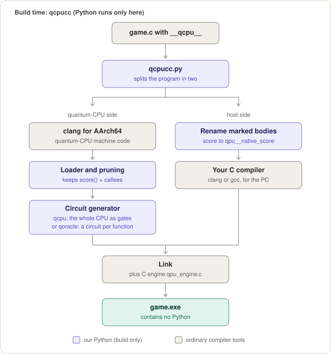
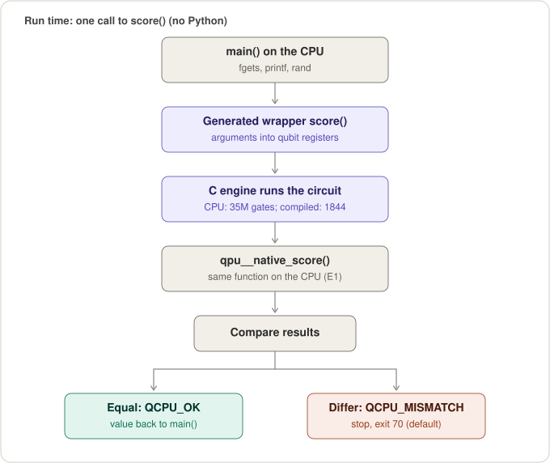

# qcpu: running marked functions on a quantum CPU — design specification

Status: **draft, partly implemented**. Sections marked *(exists)* describe code that is in this
repository (`qcpu.h`, `qcpucc.py`, `cmake/QCPU.cmake`, `runtime/qpu_engine.c`,
`examples/codebreaker/`, tests `test_qcpucc` and `test_dll`); everything else is planned.
Section 10 lists what is done.

## 1. Goal

Write one ordinary C program. Mark some of its functions with `__qcpu__`. Build it once with an
ordinary toolchain. At run time, choose **where** the marked functions run — natively on the CPU, on
the quantum CPU circuit in a simulator, or on a real quantum processor — and **how** they are turned
into a circuit, without changing the source or rebuilding.

```c
#include <stdio.h>
#include <qcpu.h>

static const int secret = 0x9C;
static int peg(int code, int k) { return (code >> (2 * k)) & 3; }

__qcpu__ int score(int guess) { /* uses peg() and secret */ }

int main(void) {
    int g;
    while (scanf("%x", &g) == 1)
        printf("%d\n", score(g));        /* an ordinary call */
}
```

```bash
qcpucc game.c -o game                    # build once
./game                                   # default: simulated quantum CPU
QCPU_MODE=native ./game                  # same binary, plain CPU
QCPU_VERIFY=0 ./game                     # only where exactness is otherwise guaranteed
```

## 2. Terms

| term | meaning |
|---|---|
| host | the computer that runs the program: macOS, Linux or Windows, any CPU |
| quantum CPU (QCPU) | the reversible stored-program machine of this repository, as a quantum circuit |
| QCPU function | a function marked `__qcpu__`, with everything it calls |
| QCPU ISA | the instruction set the QCPU function is compiled to: `arm64`, `riscv64`, `riscv32`, `x86_64` |
| mode | how a QCPU function becomes a circuit: `qcpu` (the quantum CPU runs its machine code) or `qoracle` (a circuit of the function alone); chosen at build time, one per program |
| backend | what executes the circuit: `native`, `sim`, or a driver |
| driver | a plug-in library that runs circuits on a device or service |
| configuration | ISA, register width, memory size, cycle limit, mode, backend, verification |

The four axes are independent; "any code on any configuration" means any combination that the
function's requirements allow:

```
host OS  x  QCPU ISA  x  mode  x  backend
macOS       arm64        qcpu      native
Linux       riscv64      qoracle   sim
Windows     riscv32                    driver: ibm, aer, file, ...
            x86_64
```

## 3. Source level

### 3.1 The annotation

`qcpu.h` defines one attribute macro:

```c
__qcpu__ int score(int guess);
```

- `qcpu.h` defines `__qcpu__` as empty on every build. A plain compiler sees an ordinary C program;
  `qcpu.h` then also supplies `qcpu_last_call()` and `qcpu_status_name()` as inline functions (status
  `QCPU_OK`, backend `none`), so a program that queries its calls still links *(exists)*. Under `qcpucc`
  (`__QCPUCC__`), inside the runtime, or with `QCPU_LIBRARY` (a program linking a QPU library) they come
  from the runtime.
- The build driver finds the marked definitions in the source text *(exists)*. On the host side it
  renames each marked definition to `qpu__native_<name>` (and the calls between marked functions
  inside them), so the function's own body becomes the native fallback; every other call to `<name>`
  links to the generated wrapper. Renaming in the source, rather than weak symbols, is what makes
  this reliable: a compiler may bind a call to a function defined in the same file directly, past
  any weak symbol. `#line` directives keep the compiler's messages pointing at the user's file.
- On the QCPU side the sources are compiled with `-ffunction-sections -fdata-sections`, and the
  loader keeps only the sections reachable from the marked functions through relocations
  *(exists)*.

The keyword has no run-time meaning. It decides what the build generates.

### 3.2 Rules for QCPU functions

Checked by the build; each violation is an error naming the function and the reason.

1. **External linkage**, defined in a file passed to the build.
2. **Parameters**: up to 8 integers (`int`, `long`, `unsigned`, fixed-width types), and pointers to
   `int` buffers annotated with their direction and length *(exists, `qpu-dll`)*:
   ```c
   __qcpu__ int  sum (const int *QCPU_IN(n) v, int n);
   __qcpu__ void fill(int *QCPU_OUT(n) v, int n, int x);
   __qcpu__ void sort(int *QCPU_INOUT(n) v, int n);
   ```
3. **Result**: one integer or `void`.
4. **Pure**: no I/O, no system or library calls, in the function or anything it calls. Helpers it
   calls (`peg`) and constants it reads (`secret`) are included automatically.
5. **No state between calls**: global variables are read with their initial values; writes do not
   persist to the next call.
6. **Machine limits**: the supported instruction subset of the QCPU ISA, and the reduced-width model
   (register width W ≤ 16).
7. **Semantics**: a call must return what the function returns as C code (section 5.6), or fail.
   Undefined behaviour in the source (signed overflow, oversized shifts, out-of-bounds reads) has no
   defined result on any backend.

### 3.3 Several files

Any number of files may contain `__qcpu__` functions. QCPU functions may call each other; they are
linked into one QCPU program per executable.

## 4. Build

### 4.1 Pipeline

```
game.c ──┬── QCPU side ── compile for the QCPU ISA ── keep marked functions + callees
         │                ── generate machine configuration and circuit
         │                ── emit qcpu_gen.c: circuit as data + one wrapper per function
         │
         └── host side ── compile natively: marked bodies renamed to qpu__native_<name>,
                          the native fallback and the E1 reference

qcpu_gen.c + runtime (engine, backend loader) + host objects ── link ── game
```

The circuit generator is Python and runs at build time only. The built program contains no Python.

As implemented (`qcpucc.py`; redraw with `tools/qcpu_diagrams.py`):

<p align="center"></p>

### 4.2 Command-line driver

```
qcpucc [options] files... -o output

  --qcpu-isa arm64|riscv64|riscv32|x86_64   ISA of the QCPU side (default arm64)
  --qcpu-width N                            register width, up to 16 (default 16); the code and
                                            data memory set a minimum (12 with 512 ints)
  --qcpu-memory N                           data memory in ints, power of two (default 512)
  --qcpu-max-steps N                        default cycle limit per call (default 1000000)
  --qcpu-opt N                              optimization level of the QCPU side (default 1)
  --qcpu-mode qcpu|qoracle                  qcpu: the quantum CPU runs every function (default);
                                            qoracle: a circuit per function, or a build error
  --shared                                  build a library (.dylib/.so/.dll) instead of an executable
  --cc CC                                   host compiler (default cc)
  --keep DIR                                keep the generated files
  other options                             passed to the host compiler; -l -L -Wl, -framework
                                            to the linker
```

*(exists)*

### 4.3 CMake

```cmake
include(cpu-qpu/cmake/QCPU.cmake)

add_qcpu_executable(game SOURCES game.c
                    QCPU_ISA arm64 QCPU_WIDTH 16 QCPU_MODE qoracle)

add_qcpu_library(codebreaker SHARED SOURCES codebreaker.c)    # for other programs to link
```

*(exists)*: both functions run `qcpucc` through `Python3_EXECUTABLE`;
`add_qcpu_library` gives an imported shared library target. Further arguments: `QCPU_MEMORY`,
`QCPU_MAX_STEPS`, `OPTIONS`, `LIBS`.

### 4.4 What the executable contains

| part | content |
|---|---|
| host code | the program, the wrappers, the native fallbacks, the runtime |
| QCPU program | machine code of the QCPU functions, as program-memory bits |
| circuit(s) | one machine cycle as a gate list (X, CNOT, Toffoli, Fredkin) per embedded mode |
| layout | which qubits hold the argument registers, the return register, data memory, PC, run flag |

## 5. Run time

### 5.1 A call

<p align="center"></p>

1. The call goes to the generated wrapper (the native body was renamed, section 3.1).
2. The wrapper reads the configuration (section 6) and picks the backend.
3. It builds the initial state: program bits, arguments in the argument registers, input buffers
   in data memory, return address at the halt slot.
4. The backend executes the circuit until the machine halts or the cycle limit is reached.
5. The wrapper reads the return register, output buffers and guard flags, establishes exactness
   (section 5.6), sets the call status (section 5.7), and returns the value or fails.

### 5.2 Backends

| backend | executes | status |
|---|---|---|
| `native` | the native fallback; no circuit | *exists* (`QCPU_MODE=native`) |
| `sim` | the circuit, in the exact basis-state simulator built into the runtime | *exists* (C engine) |
| driver | the circuit, through a plug-in (`libqcpu_<name>.dylib/.so/.dll`) | planned |

### 5.3 Modes

| mode (`--qcpu-mode`) | circuit | size | status |
|---|---|---|---|
| `qcpu` (default) | the quantum CPU of this repository (a von Neumann machine of gates) executes the function's machine code | large: every instruction is a machine cycle | *exists* |
| `qoracle` | the function compiled directly to reversible logic (qoracle) | small: e.g. 26 qubits instead of 1,242 | *exists*; section 5.5 |

The mode is chosen at build time, and a program contains the circuits of that mode only: every
`__qcpu__` function of a `qoracle` build has its own circuit, or the build fails and names the reason;
a `qoracle` program does not carry the quantum CPU (Code Breaker: 50 KB instead of 1.8 MB).
`--qcpu-mode qcpu,qoracle` embeds both.

At run time the same keywords select what runs, with one setting *(exists)*:

| `QCPU_MODE` | runs | available |
|---|---|---|
| `qcpu` | the quantum CPU | when built with `qcpu` |
| `qoracle` | the function's own circuit | when built with `qoracle` |
| `native` | the native fallback; no circuit | always |
| (not set) | the mode the program was built with; the first one if both | |

A mode the program was not built with stops the call with a message naming the build option.
`QCPU_BACKEND=native` is the older name of `QCPU_MODE=native`; `QCPU_BACKEND` is kept for the
choice between the simulator and a hardware driver.

### 5.4 Driver interface

```c
typedef struct {
    uint32_t nqubits;
    const uint32_t *gates; long ngates;     /* op << 30 | q0, q1, q2  (x, cx, ccx, cswap) */
    const uint32_t *ones;  long nones;      /* initial basis state: qubits set to 1 */
    const uint32_t *measure; long nmeasure; /* output qubits, in result order */
    const uint32_t *flags;   long nflags;   /* guard flags; a shot with a flag at 1 is not accepted */
    const uint32_t *work;    long nwork;    /* work qubits; must read 0 in an accepted shot */
    long cycles;                            /* repetitions of the gate list, for drivers that loop */
} qcpu_job;

typedef struct {
    const char *name;
    int  (*capacity)(uint32_t *max_qubits, long *max_gates);
    /* runs the job for `shots` shots; fills counts (section 5.8). A simulator driver may run one shot. */
    int  (*run)(const qcpu_job *job, long shots, qcpu_counts *counts, char *err, size_t errlen);
} qcpu_driver;

const qcpu_driver *qcpu_driver_entry(void);  /* exported by every driver library */
```

The runtime asks `capacity` first and refuses jobs that do not fit, with the numbers ("circuit needs
N qubits, device has M"). Planned drivers: `file` (writes OpenQASM 3 for inspection), `aer` (Qiskit
Aer, through a small helper process), `ibm` (IBM Quantum; usable only for compiled-mode circuits small
enough for the device).

### 5.5 qoracle mode: a small dedicated circuit per function

*(exists in part: `qcpucc --qcpu-mode qoracle`, see section 10 step 4 for what is still planned)*

The interpreter runs any supported machine code, but every executed instruction costs a full machine
cycle, so its circuits are far too large for any existing quantum computer. qoracle mode builds,
for each `__qcpu__` function, a circuit that computes only that function: no program counter, no
fetch, no decode. This is what qoracle (`github.com/quantag/qoracle`) does today for single
functions; `qoracle` mode embeds its output.

**How the circuit is made** (qoracle, at build time):
1. compile the function for AArch64;
2. execute the machine code symbolically on all paths: every register bit becomes a Boolean formula of
   the input bits, branches are merged, loops are unrolled to a bound (section 5.5.2);
3. reduce the formulas to an AND/XOR network (hash-consing, constant folding);
4. map it to gates: a Toffoli per AND, CNOTs per XOR, Bennett copy-out and uncompute, so that all work
   qubits return to 0;
5. verify the circuit against the real machine code in a CPU emulator: on all inputs up to 16 input
   bits, otherwise on edge cases and 4,096 random inputs. A function that fails is not embedded.
   Sampled verification is evidence, not proof; section 5.6 says what a call may rely on.

The circuit always has the **compute-oracle form**

```
U_f |x⟩|y⟩|f⟩|0…0⟩ = |x⟩|y ⊕ f(x)⟩|f ⊕ flags(x)⟩|0…0⟩
```

with input register `x` (the declared argument bits), output register `y` (the declared result bits),
a flag register `f` (section 5.5.2) and work qubits that start and end in 0.

**Input and output widths.** A compiled circuit needs to know how many bits each argument really
uses; the fewer, the smaller the circuit. Annotations give them:

```c
__qcpu__ int QCPU_RESULT_BITS(6) score(int QCPU_BITS(8) guess);
```

`QCPU_BITS(n)` declares an unsigned range (0 .. 2^n − 1), `QCPU_SBITS(n)` a signed one (−2^(n−1) ..
2^(n−1) − 1). Without annotations the build uses the parameter's C type on the quantum CPU (`int`: 32
bits, signed), and reports the circuit size so that the annotation can be tightened. Values outside the
declared width are an error at the call (the wrapper checks them before running the circuit):
`QCPU_BAD_ARGS` *(exists)*.

`QCPU_RESULT_BITS(n)` is a claim about the function, so the build must prove it: every result bit above
`n` must be the constant 0 in the logic network for all inputs of the declared domain (by construction,
or by a SAT check of the bit). If it cannot be proven, the build fails ("`score`: result bit 6 can be 1,
e.g. for guess = …"); the result is never silently truncated.

*As implemented:* when every input of the domain is tested (at most 16 input bits), the machine code is
run on all of them and every result must fit; otherwise the bits above `n` must be constant 0 in the logic
network. SAT checks are planned. Messages: "`f`: QCPU_RESULT_BITS(4) is wrong: for a = 15 the result is
16", "… cannot be proven: its inputs total 64 bits, too many to test all, and result bit 4 is not
constant 0 in the logic".

#### 5.5.1 Ordinary calls and coherent use

The same compute oracle serves both uses, with different inputs and readouts:

| use | prepare | readout | meaning |
|---|---|---|---|
| ordinary call | `x` = argument (basis state), `y` = 0, `f` = 0 | measure `y` and `f` (and the work qubits, section 5.8) | `y` = f(x) |
| phase oracle (1-bit result) | `x` = superposition, `y` = `|−⟩` | none: `y` stays `|−⟩` | phase kickback: `|x⟩ → (−1)^{f(x)} |x⟩` |
| compute oracle | `x` = superposition, `y` = `|0…0⟩` | by the algorithm | `y` entangled with `x` |

A phase flip on a single basis input is not observable, so phase oracles are never used for ordinary
calls. Coherent use requires that the flag register stays 0 for every input in the domain, that is a
proven loop bound and proven table ranges (section 5.5.2); otherwise the flags would be entangled with
the input. Direct tests: basis inputs against the native function, and, for the phase use, the state
after `H^n · U_f · H^n` on `|0…0⟩|−⟩` compared with the exact expected state vector.

**Export for quantum programs** *(exists)*: `qcpucc --qcpu-mode qoracle --qcpu-export DIR` writes each
function's circuit for other toolkits: OpenQASM 3 (`f.qasm`, compute oracle), CUDA-Q kernels (`f_cudaq.py`
with `@cudaq.kernel f_oracle(q)`, `f.cudaq.h` with `__qpu__ void f_oracle(cudaq::qview<> q)`) and the
register layout (`f.json`: inputs, result, work qubits). For a one-bit result the build also makes the
phase oracle `f_phase` (`|x⟩|0⟩ → (−1)^{f(x)} |x⟩|0⟩`, with a Z on the result literal instead of a copy,
no `|−⟩` qubit needed), checked like the compute oracle. Only functions whose circuits need no guard
flags are exported, so the work qubits are 0 for every input in the domain and coherent use is exact.
Tested: every input through the exported compute oracles; Qiskit loads the files; in CUDA-Q 0.17 the
Python kernels are right for every input and Grover with the phase kernel finds the marked value; the
C++ header type-checks against CUDA-Q's `cudaq.h` (not yet compiled with `nvq++`). Example: Grover's
search for the Code Breaker secret with the game's scoring as the oracle (`examples/codebreaker/solver.c`).

#### 5.5.2 Loop bounds and other guards

Unrolling needs a bound, and a symbolic execution can also reach states the circuit cannot represent
(a table read outside the table). The logic network computes, for every input, a flag that is 1 exactly
when the input needs more iterations than were unrolled (`unfinished`), and one for a table index out
of range (`out_of_range`). Both are part of the circuit (register `f`). A bound is accepted in one of
three ways:

| bound | how it is established | circuit | at run time |
|---|---|---|---|
| exhaustive | the function is run on every input of the domain (domain ≤ 2^16 inputs) | flags proven 0 | nothing to check |
| proven | a SAT check shows that `unfinished` and `out_of_range` are 0 for every input of the domain | flags proven 0 | nothing to check |
| explicit or sampled | `QCPU_LOOP_BOUND(n)` on the function, or the bound measured on sampled inputs | flags kept | the wrapper reads `f`; a set flag fails the call with status `QCPU_INCOMPLETE` |

A circuit with unproven flags is valid for ordinary calls (a failure is detected, never wrong) but not
for coherent use; the build records which kind each embedded circuit is. A bound measured on samples
alone is never treated as proven.

**What qoracle mode supports** (the current qoracle front end):

| supported | not yet |
|---|---|
| integer arithmetic incl. multiply, divide, shifts | writing memory: local arrays, pointers, the stack (`-O0`) |
| branches, conditional selects, bounded loops | calls that the compiler does not inline |
| read-only tables (`static const` arrays), switch tables | floating point |
| AArch64 | RISC-V, x86-64 |

A function outside this set is a build error in `qoracle` mode, with the reason, for example
"`bump`: no qoracle circuit: it takes buffers (qoracle circuits cannot write memory yet). Build with
--qcpu-mode qcpu (the default)".

**Measured sizes** (qoracle, clang -O1, verified on all inputs):

| function | inputs | qubits | Toffoli | all gates | qcpu, for comparison |
|---|---|---|---|---|---|
| `is_root` (Grover predicate), compute oracle, 1-bit result | 4 bits | 26 | 28 | 67 | 1,242 qubits, 98,504 gates |
| Code Breaker `score(guess)`, secret fixed, 6-bit result | 8 bits | 312 | 358 | 1,088 | 167,670 qubits, 14.3 million gates (one call, 245 cycles) |
| Code Breaker `score(guess, secret)`, 6-bit result, built by `qcpucc --qcpu-mode qoracle` *(exists)* | 16 bits | 544 | 614 | 1,844 | 565k qubits, 35.3 million gates (one call, 245 cycles) |
| Code Breaker `score` with colour-count arrays | 8 bits | — | — | — | rejected: writes local arrays |

**Running a compiled circuit on hardware.** For an ordinary call the input is a basis state, so the
driver job is: X gates to set the input bits, the compiled circuit, measurement of the result, flag
and work qubits, repeated for a number of shots. The ideal answer is deterministic, and every work qubit
must end in 0; a shot with a work qubit at 1 is certainly corrupted and is discarded. These checks catch
some errors, not all: an output bit can flip while every work qubit reads 0. What a hardware call
returns, and when it succeeds, is defined in section 5.8.

**What fits today.** Small predicates and arithmetic on a few bits — `is_root`: 26 qubits and
28 Toffoli gates — are within reach of current devices, as circuits; whether the answers are reliable
on a given device is what section 5.8 measures. Code Breaker's `score` (312 qubits,
358 Toffoli gates, depth 165) is beyond what current noisy devices run reliably; qubit reuse and
measurement-based uncomputation (qoracle roadmap) are the way to bring such functions closer. A
driver refuses a circuit beyond its `capacity` (section 5.4); such a program runs on the simulator.

**Quantum use.** The same compiled circuit, given an input in superposition, is an oracle, as in
section 5.5.1: with a `|−⟩` output for Grover search (find the secret code from a 1-bit
`is_secret(guess)`), or as a compute oracle in period finding. That is outside ordinary calls
(section 11), but the circuit is the same.

#### 5.5.3 Quantum search from C: `qcpu_search()` *(exists)*

`int qcpu_search(int (*f)(int), int bits, int *x)` finds an `x` in `0 .. 2^bits − 1` with `f(x) = 1`.
`f` is a `__qcpu__` function of one `QCPU_BITS(bits)` argument with `QCPU_RESULT_BITS(1)`. In a
`--qcpu-mode qoracle` build, `qcpucc` also embeds `f`'s phase oracle, and the runtime runs Grover's
search with it: the randomized form for an unknown number of solutions (Boyer, Brassard, Høyer, Tapp
1998), each measured answer checked with an ordinary call of `f` (so under E1); 0 after about 4.5·√N
oracle calls. The simulation keeps the 2^bits amplitudes of the argument register (every other qubit is
0 between calls) and obtains the oracle's phases by running its gates on each basis input once;
`bits` ≤ 24. Without a phase oracle (`QCPU_MODE=native` or `qcpu`, a `qcpu` build), or built by a plain
compiler (`qcpu.h`), the search is classical: every input in turn, the same answer. `qcpu_last_call()`:
mode `"grover"` or `"classical"`, oracle calls in `cycles`. `QCPU_SEED` makes the measurements
repeatable. Errors: `bits` other than the declared width, `QCPU_MODE=qoracle` without a phase oracle
(`QCPU_BAD_ARGS`). On hardware, the same search would send the phase oracle to the device (section 5.4).

### 5.6 Exactness: what a call returns

**Contract.** By default a `__qcpu__` call returns exactly the value the function returns as C code on
the host, with the same output buffers, or it fails with a status. It never returns an approximate value
silently. A reduced-width machine can be wrong even when the input and the result both fit: for
`uint32_t f(uint32_t x) { return (x << 8) >> 8; }` at W = 8, `f(1)` is 1, but a machine that truncates
after the left shift returns 0. (The test uses W = 12, the narrowest machine that holds its code and
memory, and `f(16)`: 16 << 8 = 4096 needs 13 bits.) Checking only inputs and results misses this, so every backend needs one
of the following guarantees for every call:

| guarantee | how | available for |
|---|---|---|
| E1, per-call check | the native fallback is run and the results compared; a difference fails the call | every backend (`QCPU_VERIFY`, on by default) |
| E2, per-call model check | the simulator checks every executed instruction against the reduced-width model (every written register fits its width, flags, branches, addresses, as the CPU reference of this repository does) | `qcpu` mode on `sim`, when the data models agree (5.6.1) |
| E3, build-time proof | the compiled circuit equals the machine code on the whole declared domain: exhaustive verification, or a SAT equivalence check; plus proven result width and guards | `qoracle` mode on `sim`, when proven and the data models agree (5.6.1) |

**`QCPU_EXACT=1` (the default) is decisive.** A call returns `QCPU_OK` only with E1, E2 or E3 as defined
here; otherwise it fails with `QCPU_UNVERIFIED`. In particular, **a hardware result needs E1**: E2 is
impossible on hardware, and E3 proves the circuit, not that the device ran it correctly. A hardware call
with `QCPU_VERIFY=0` therefore fails with `QCPU_UNVERIFIED`, however clear the vote. Only with
`QCPU_EXACT=0` may a call return an unconfirmed value: `QCPU_PROBABLE` for a hardware vote that meets the
evidence thresholds (section 5.8), `QCPU_UNCHECKED` for any other unchecked result. The call log records
both.

#### 5.6.1 Host and target C semantics

E2 and E3 compare the QCPU with the *target* machine code, while the contract promises the *host*
result. The two agree only if the host and target compilers give the C program the same meaning. They
often do not: `__qcpu__ int f(void) { return sizeof(long); }` returns 4 on a Windows x64 host and 8 when
compiled for AArch64 Linux. Both values fit at W = 8, the function has a single input case, no undefined
behaviour, and exhaustive verification against the target code passes, yet the results differ. Measured
with clang:

| target | `long` | `wchar_t` | `long double` | `char` |
|---|---|---|---|---|
| AArch64 Linux, RISC-V Linux | 8 | 4 | 16 | unsigned |
| x86-64 Linux | 8 | 4 | 16 | signed |
| AArch64 macOS | 8 | 4 | 8 | signed |
| x86-64 and AArch64 Windows | 4 | 2 | 8 | signed |

So even a Linux x86-64 host and an AArch64 Linux target disagree (on `char`).

The build therefore:
1. compiles the QCPU side for the target whose data model is closest to the host's (AArch64 macOS for
   a macOS host, AArch64 Linux elsewhere) and adds flags that remove differences where a flag exists
   (`-fsigned-char` / `-funsigned-char`);
2. compares the remaining **data-model facts** of the two compilers with a probe: size, alignment and
   signedness of every integer type, `char`, `wchar_t`, `size_t`, pointers, `enum`, and the layout of every
   struct, union and bit-field type that a `__qcpu__` function uses;
3. enables E2 and E3 only for functions whose facts all agree. For the others, E1 is required, and the
   build lists the differing facts ("`f`: `sizeof(long)` is 4 on the host, 8 on the QCPU target").

Undefined behaviour stays outside the contract: where the C standard leaves a result undefined, the
native fallback and the QCPU may differ, and E1 reports the difference rather than choosing one. The
portability test suite includes `sizeof(long)`, a `char` comparison (`(char)200 < 0`) and a struct
layout case, built for every host system.

#### 5.6.2 Buffers under verification

E1 runs the function twice, natively and on the QCPU, and must not let either run see the other's
writes. For `void increment(int *QCPU_INOUT(1) p)`:
1. the wrapper copies the caller's input and in/out buffers into **two independent snapshots**, one per
   execution; both start from the caller's original values;
2. each execution reads and writes only its own snapshot;
3. the results are compared: return values and every output and in/out buffer;
4. on success, the selected outputs are copied back to the caller's buffers **exactly once**;
5. on failure, the caller's buffers are left **untouched**, whatever `QCPU_ON_FAIL` says about the
   return value (with `QCPU_ON_FAIL=native`, the native snapshot is copied back, once).

Without E1 the same rules apply to the single execution: it works on a snapshot, and the caller's
buffers change only when the call succeeds.

**Aliasing.** Two buffer parameters of one call may overlap only if they are the same buffer with the same
length; this aliasing is then preserved inside each snapshot (one copy, referenced by both parameters).
Any other overlap is rejected before the call with `QCPU_BAD_ARGS`.

### 5.7 Call status

Every call sets a status that the program can read with `qcpu_last_call(&info)`:

| status | meaning | the call |
|---|---|---|
| `QCPU_OK` | exact result (E1, or E2/E3 with agreeing data models) | returns the value |
| `QCPU_MISMATCH` | E1 found a difference | fails |
| `QCPU_INEXACT` | E2 found a value outside the reduced-width model | fails |
| `QCPU_INCOMPLETE` | a guard flag was set (loop bound, table range) or the cycle limit was reached | fails |
| `QCPU_TRAP` | the machine reached an instruction it does not implement | fails |
| `QCPU_TIE`, `QCPU_INSUFFICIENT` | a hardware call without enough evidence (section 5.8) | fails |
| `QCPU_UNVERIFIED` | `QCPU_EXACT=1` and no guarantee applies, for example a hardware result with `QCPU_VERIFY=0` | fails |
| `QCPU_BAD_ARGS` | an argument outside its `QCPU_BITS`, or overlapping buffers | fails |
| `QCPU_PROBABLE` | only with `QCPU_EXACT=0`: a hardware result that meets the evidence thresholds, without E1 | returns the value |
| `QCPU_UNCHECKED` | `QCPU_EXACT=0` and no guarantee applied | returns the value |

"Fails" means: with `QCPU_ON_FAIL=abort` (default) the program stops with a message; with `native` the
native fallback's result is returned and the status is kept; with `status` the call returns 0 and the
program decides from `qcpu_last_call`. In every case a failed call leaves the caller's buffers untouched,
except that `native` copies back the native result (section 5.6.2).

### 5.8 Hardware calls: the result contract

A driver returns evidence, not a value:

```c
typedef struct { const uint8_t *bits; long count; } qcpu_outcome;   /* one measured bit string */

typedef struct {
    long shots;                    /* shots run */
    long accepted;                 /* shots with all work qubits 0 and all flags 0 */
    long discarded_work;           /* shots with a work qubit at 1 */
    long discarded_flag;           /* shots with a guard flag at 1 */
    const qcpu_outcome *outcomes;  /* counts of the output strings among accepted shots */
    long noutcomes;
} qcpu_counts;
```

The runtime turns the counts into a result. With `a` accepted shots, `c1` the count of the most frequent
output string and `c2` of the second:
- `QCPU_INSUFFICIENT` if `a < QCPU_MIN_ACCEPTED` (default 8);
- `QCPU_TIE` if `c1 − c2 < QCPU_MIN_MARGIN` (default 3) or `c1 / a < QCPU_MIN_SHARE` (default 0.6);
- otherwise the most frequent string. With E1 confirming it, the status is `QCPU_OK`; with E1 finding a
  difference, `QCPU_MISMATCH`. Without E1, the status is `QCPU_UNVERIFIED` (a failure) under
  `QCPU_EXACT=1`, and `QCPU_PROBABLE` only under `QCPU_EXACT=0`: E3 proves that the circuit is right, not
  that the device ran it correctly, and a vote is statistical evidence, not proof.

`qcpu_last_call` exposes the full counts, so a 16-to-0 vote and a 2-to-1 vote after 13 discarded shots
are distinguishable. The defaults are starting values, to be calibrated per device; the call log records
the counts of every hardware call.

## 6. Configuration

### 6.1 Settings

| setting | values | default |
|---|---|---|
| `QCPU_MODE` | `qcpu`, `qoracle`, `native` | the built mode (the first one if both) |
| `QCPU_SEED` | an integer: the measurements of `qcpu_search` | from the clock |
| `QCPU_BACKEND` | `sim`, driver name (planned); `native` = `QCPU_MODE=native` | `sim` |
| `QCPU_SHOTS` | shots per call on a hardware driver | `32` |
| `QCPU_VERIFY` | `0`, `1`: compare every call with the native fallback (E1) | `1` |
| `QCPU_EXACT` | `1`: a call needs E1, E2 or E3; `0`: unchecked results allowed, status `QCPU_UNCHECKED` | `1` |
| `QCPU_ON_FAIL` | `abort`, `native`, `status` (section 5.7) | `abort` |
| `QCPU_MIN_ACCEPTED`, `QCPU_MIN_MARGIN`, `QCPU_MIN_SHARE` | evidence needed for a hardware result (section 5.8) | `8`, `3`, `0.6` |
| `QCPU_MAX_STEPS` | cycles per call | build value |
| `QCPU_QUIET` | `0`, `1` | `0` |
| `QCPU_DRIVER_PATH` | directories searched for drivers | next to the executable |
| `QCPU_LOG` | file for a per-call log: function, mode, backend, cycles, qubits, gates, time | none |

### 6.2 Where settings come from (later overrides earlier)

1. values given at build time;
2. `qcpu.toml` next to the executable, then in the working directory;
3. environment variables;
4. per function: `QCPU_MODE_score=native` (environment) or a `[function.score]` table;
5. from the program: `qcpu_set("backend", "native")`.

```toml
backend = "sim"
verify  = true

[function.score]
backend = "native"          # this one on the CPU, the others simulated
```

The `QPU_*` variables of the `qpu-dll` branch are accepted as aliases.

## 7. Verification

`QCPU_VERIFY=1` (the default) runs the native fallback on every call and compares the return value and
the output buffers; this is guarantee E1 of section 5.6. A difference is reported with the function,
the arguments and both results, and the call fails with `QCPU_MISMATCH`. `QCPU_VERIFY=0` is only
allowed where E2 or E3 applies, or together with `QCPU_EXACT=0`.

## 8. Errors and limits

| situation | detected | result |
|---|---|---|
| I/O or library call in a QCPU function | build | error naming the call |
| unsupported instruction | build | error naming the instruction and function |
| state shared between calls | build (writes to globals) | warning |
| value does not fit the register width | run: E1 (difference) or E2 (model check) | `QCPU_MISMATCH` / `QCPU_INEXACT` |
| no exactness guarantee for the call | run | `QCPU_UNVERIFIED`, unless `QCPU_EXACT=0` |
| loop bound or table range exceeded (unproven guard) | run, from the flag register | `QCPU_INCOMPLETE` |
| `QCPU_RESULT_BITS` cannot be proven | build | error with an input that needs more bits |
| cycle limit reached | run | error; `QCPU_MAX_STEPS` raises it |
| circuit too large for a driver | run | refused with the sizes |
| function outside qoracle's support | build (`qoracle` mode) | error naming the reason; `--qcpu-mode qcpu` runs it |
| argument wider than its `QCPU_BITS`, or overlapping buffers | run, before the circuit | `QCPU_BAD_ARGS` |
| host and target data models differ for a function | build | E1 required for it; the differing facts listed |
| work qubit or flag measured as 1 on hardware | run | that shot is discarded and counted |
| too little evidence on hardware | run | `QCPU_INSUFFICIENT` / `QCPU_TIE`, with the counts |

## 9. Portability

| host | build output | status |
|---|---|---|
| Linux x86-64, ARM64 | executable / `.so` | `qcpucc` and engine *exist*, tested in CI; driver planned |
| macOS (Apple Silicon) | executable / `.dylib` | `qcpucc` and engine *exist*, tested in CI (Apple clang); driver planned |
| Windows x86-64 | executable / `.dll` (clang with MSVC, MinGW) | `qcpucc` and engine *exist*, tested in CI (clang, MSVC linker); MinGW cross-built; driver planned. `long` is 4 bytes here and 8 on the quantum CPU: E1 catches every difference (`QCPU_MISMATCH`) |

`test_qcpucc` runs on all four in `.github/workflows/qcpucc.yml`.

| QCPU ISA | qcpu | qoracle |
|---|---|---|
| arm64 | *exists* (`qcpucc` default, library build) | *exists* (`--qcpu-mode qoracle`) |
| riscv64, riscv32 | *exists* (library build; `--qcpu-isa`) | — |
| x86_64 | *exists* (library build; `--qcpu-isa`) | — |

## 10. Implementation plan

1. *Done.* `qpu-dll` merged with current `main`; `QPU_*` renamed to `QCPU_*` with aliases. (macOS
   `.dylib`: built by `qcpucc --shared`, not yet run on a Mac.)
2. *Done.* `qcpu.h`, `__qcpu__`, the `qcpucc` driver: source split with renamed native bodies,
   call-graph pruning, stand-in C headers for the QCPU side, the data-model probe (5.6.1).
3. *Done except E2.* E1 by default, `qcpu_last_call`, `QCPU_ON_FAIL`, all statuses, buffer snapshots
   (5.6.2). E2 (the reference's model checks ported to the C engine) is still planned.
4. *Partly done.* qoracle mode: `--qcpu-mode qoracle`, `QCPU_BITS` /
   `QCPU_SBITS` / `QCPU_RESULT_BITS` with proven result width, `QCPU_BAD_ARGS`; circuits embedded only
   when their loop bound is exact (all inputs tested) or there are no loops and tables, so no guard flags
   are needed. Still planned: guard flags in the emitted circuit for sampled bounds, SAT proofs, E3.
5. *Done.* CMake module `QCPU.cmake`.
6. *Done* (`tests/test_qcpucc.py`, both modes, Linux x86-64 and ARM64, macOS, Windows in CI). Example: interactive Code Breaker
   (`examples/codebreaker/`) in both modes, tests on all three host
   systems. Regression cases for every backend: `(x << 8) >> 8`, written so that the truncating
   intermediate really exists in the machine code (the test checks the emitted instructions: an
   optimizing compiler may turn the expression into a mask, `and w0, w0, #0xffffff`, and remove the
   intermediate value); `sizeof(long)`, `(char)200 < 0` and a struct layout across host systems;
   `increment(int *QCPU_INOUT(1) p)` under E1, and a failed call leaving its buffers untouched.
7. *Done in part:* qoracle circuits exported for quantum programs (`--qcpu-export`: OpenQASM 3, CUDA-Q
   Python and C++, JSON). Still planned: QIR, the driver interface with counts; `file` driver (OpenQASM 3), then `aer` and `ibm` for compiled circuits
   that fit, with the result contract of section 5.8.
8. Configuration file and per-function settings; call log.

## 11. Open questions

- Pointers to data other than `int` buffers (`char`, structs) — needs byte memory access on the QCPU.
- Persistent QCPU state between calls (a QCPU "object" with its own memory) — conflicts with the
  rule that a call leaves no history behind; possible as explicit in/out buffers.
- Batched and superposed calls: `score` evaluated on a superposition of guesses, as an oracle inside
  a quantum algorithm — an API beyond ordinary calls.
- Asynchronous calls for slow drivers (`qcpu_call_async`, futures).
- Whether `compiled` mode should become the default when it is available.
- Writing memory in qoracle mode (local arrays) — a quantum RAM inside the compiled circuit, planned
  in qoracle.
- Making qoracle a library dependency of cpu-qpu, or calling it as a separate tool at build time.
